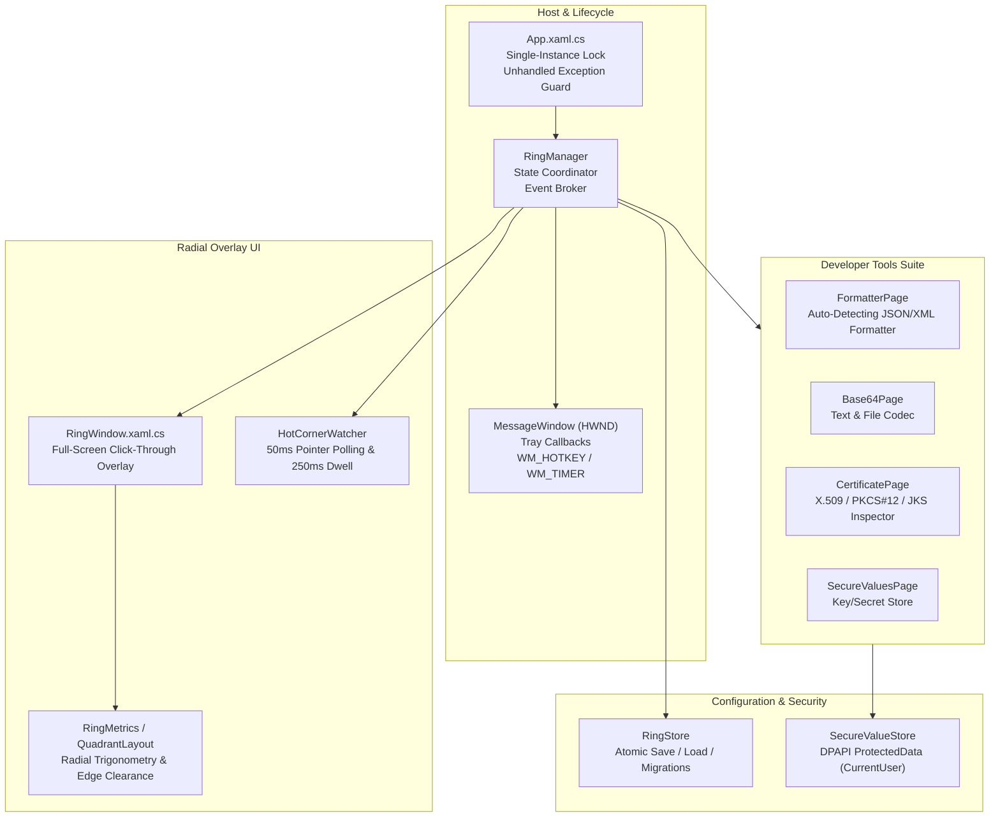

# SwiftX — Technical Design Document & Architecture Specification

**Version:** 2.0  
**Target Platform:** Windows 10 (1809+) / Windows 11  
**Runtime:** .NET 10.0 (WinUI 3 / Windows App SDK)  
**Architecture:** x64 / ARM64  

---

## 1. System Overview & Vision

**SwiftX** is a high-performance, non-intrusive radial launcher, quick-access dock, and developer utility suite for Windows. It provides zero-latency access to applications, shortcuts, web links, groups, and essential developer tools (JSON/XML data formatter, DPAPI-encrypted secure key/secret storage, Base64 codec, and X.509/PKCS#12/JKS certificate inspector).

### Core Architectural Tenets:
1. **Zero External Dependencies / Self-Contained**: 100% local processing; zero telemetry, zero cloud calls, zero accounts.
2. **Transparent, Input-Preserving Overlay**: Renders as a full-screen borderless window that passes all non-item mouse clicks directly to underlying applications using Win32 elliptical clipping.
3. **Rigorous Defensive Engineering**: Strict parse-bomb ceilings (§22), entity expansion mitigations (§21), and debounced asynchronous pipelines (§10.2).
4. **Adaptive Geometry**: Unified radial math derived from a single anchor radius for both full-circle rings and screen-corner quadrants.
5. **Windows 11 Fluent Standards**: System-integrated theme tracking, strict accessibility contracts, Narrator automation naming, and full High Contrast support (§13.3).

---

## 2. System Architecture & Component Diagram



---

## 3. The Radial Ring Engine

### 3.1 Slot Distribution & Ring Topology
The radial ring is centered dynamically around the mouse cursor or screen midpoint. It features **8 slots** spaced $45^\circ$ apart, beginning at Slot 0 (straight up, $0^\circ / 12\text{ o'clock}$) and advancing clockwise:

```
                  Slot 0 (0°)
                      ▲
       Slot 7 (315°)  │  Slot 1 (45°)
             ▲        │        ▲
               \      │      /
      Slot 6 (270°) ── HUB ── Slot 2 (90°)
               /      │      \
             ▼        │        ▼
       Slot 5 (225°)  │  Slot 3 (135°)
                      ▼
                  Slot 4 (180°)
```

- **Hub**: Fixed-size center circular emblem. Clicking the hub closes any open outer flyout ring or dismisses the overlay.
- **Slots 0 to 5 (User Slots)**: Filled sequentially from the user's item list (`RingProfile.Items`). Empty slots are omitted from the draw pass.
- **Slot 6 (Settings Group / Quick Action)**: System-synthesized entry. Hovering reveals the **Add New** action; clicking opens the Settings window.
- **Slot 7 (Close Action)**: System-synthesized entry. Quits the application. Features a unique inverted hover behavior (shrinks under cursor rather than grows; turns critical red).
- **Concentric Flyout (Outer Ring)**: When hovering a group item, an outer concentric ring fans open with up to 8 child items. The inner ring remains stationary to preserve muscle memory.

### 3.2 Overlay Input & Hit-Testing (§9)
- **Problem**: Full-screen transparent overlay windows in Windows normally capture all mouse input, blocking user interactions with applications underneath.
- **Solution (`WindowChrome.SetEllipticHitRegions`)**: SwiftX utilizes native Win32 `SetWindowRgn` / `CreateEllipticRgn` to set exact geometric clipping regions around drawn items and active hover pills.
- **Result**: Every pixel outside the item circles is genuine click-through.

---

## 4. The Hot Corner & Corner Quadrant

### 4.1 Trigger Mechanics
- **Trigger Patch**: $6\text{ px} \times 6\text{ px}$ square located at the extreme pixel corner of the active monitor.
- **Dwell Time**: Cursor must dwell in the patch for continuous **$250\text{ ms}$**.
- **Re-Arm Guard**: Must leave the trigger patch before re-triggering.
- **Drag Guard**: Active mouse button presses immediately suppress dwell activation to avoid interfering with Windows window snapping or text selection.
- **Polling**: Lightweight $50\text{ ms}$ timer on `MessageWindow` (no global low-level mouse hook).

### 4.2 Quadrant Geometry (`QuadrantLayout.cs`)
When configured for **Quadrant Mode**, the ring adapts into a $90^\circ$ quarter-circle centered directly on the screen corner:
- **Dynamic Arc Expansion**: Starts at base radius ($100\text{ px}$) and dynamically expands until adjacent items maintain minimum separation ($8\text{ px}$) and boundary items clear monitor edges ($12\text{ px}$).
- **Default 4 Items**:
  1. `QuickAccess`: Live aggregation of all web links and shortcuts on the ring.
  2. `Notepad`: Dedicated launcher or system fallback.
  3. `Tools`: Built-in developer tools group.
  4. `Settings`: Configuration shell.

---

## 5. Developer Tools Specification

### 5.1 Data Formatter (`FormatterPage.cs`, `JsonFormat.cs`, `XmlFormat.cs`)
- **Auto-Detection**: Fast heuristic evaluation (`{`, `[`, or `<`) detects JSON or XML instantly without full document parsing.
- **JSON Formatting (§14.1)**:
  - Backed exclusively by `System.Text.Json`.
  - Raw number preservation: Round-tripped through `JsonElement.GetRawText()` to prevent double-precision rounding of 64-bit/128-bit integers or monetary values.
  - Encoder safety: Uses `JavaScriptEncoder.UnsafeRelaxedJsonEscaping` to prevent unwanted ASCII entity over-escaping (`\u003C`, etc.) on local text.
- **XML Formatting & Security (§21)**:
  - Hardened `XmlReaderSettings`: `DtdProcessing = DtdProcessing.Prohibit`, `XmlResolver = null`, and `MaxCharactersFromEntities = 1024`.
  - Defense against XML External Entity (XXE) injection and Billion Laughs / quadratic entity expansion.
  - Whitespace normalization: `IgnoreWhitespace = true` prevents no-op formatting on pre-indented documents.
- **Code Editor & Syntax Highlighting (§10.2)**:
  - Backed by WinUI `RichEditBox` with custom line-number gutter.
  - Asynchronous debounced highlighting ($180\text{ ms}$).
  - Safety ceiling: Skips tokenization on text exceeding $100{,}000$ characters to maintain smooth 60 FPS typing.
- **Structural Outlining / Code Folding**:
  - `FoldFinder.cs` analyzes AST token boundaries (`{...}`, `[...]`, `<tag>...</tag>`).
  - `FoldRenderer.cs` computes visible line markers (`▾`/`▸`) and collapses inner ranges seamlessly.

### 5.2 Secure Values Store (`SecureValuesPage.cs`, `SecureValueStore.cs`)
- **Encryption Model**: Full-file payload encryption using Windows Data Protection API (`ProtectedData.Protect`, `DataProtectionScope.CurrentUser`).
- **Metadata Protection**: Key names and values are serialized together before DPAPI encryption, ensuring key names (e.g. `AWS_SECRET_ACCESS_KEY`) are never exposed in plaintext.
- **UI Masking**: Masked on screen (`ValueMasking.Mask`) with one-click clipboard copy.
- **Commit Semantics**: Explicit commit only on `Enter` or header Save; avoids premature auto-commits on focus loss.

### 5.3 Base64 Codec (`Base64Page.cs`, `Base64Codec.cs`)
- **Forgiving Ingestion**: Automatically cleans MIME wraps, whitespace, newlines, and padding.
- **URL-Safe Support**: RFC 4648 URL-safe alphabet translation (`+` $\rightarrow$ `-`, `/` $\rightarrow$ `_`, stripped `=`).
- **File Mode**: Direct binary file ingestion bounded by $256\text{ MB}$ ceiling.

### 5.4 Certificate Inspector (`CertificatePage.cs`, `CertificateReader.cs`)
- **Supported Formats**: Single X.509 (`.cer`, `.crt`, `.der`, `.pem`), PKCS#7 bundles (`.p7b`, `.p7c`), password-protected PKCS#12/PFX (`.p12`, `.pfx`), and Java KeyStore (`.jks`, `.keystore`).
- **Ephemeral Keys**: Loads private keys into memory with `X509KeyStorageFlags.EphemeralKeySet` — never persists keys into Windows certificate stores.
- **Field Inspector**: Form-based field breakdown including Subject, Issuer, Serial, Valid From/To, Subject Alternative Names (SAN), Key Usage, SHA-1/SHA-256 fingerprints, and countdown badges.

---

## 6. Safety Ceilings & Resource Boundaries (§22)

To guarantee that SwiftX never crashes, hangs, or exhausts system resources:

| Boundary | Ceiling | Enforcement Mechanism |
| :--- | :--- | :--- |
| **Text File Ingestion** | $50\text{ MB}$ | `InputLimits.ReadTextAsync` pre-read metadata inspection |
| **Binary File Ingestion** | $256\text{ MB}$ | `InputLimits.ReadBytesAsync` pre-read metadata inspection |
| **Custom Icon Ingestion** | $16\text{ MB}$ | Pre-decode image header boundary check |
| **Config Import** | $8\text{ MB}$ | Pre-parse JSON size limit |
| **Editor Syntax Highlighting** | $100{,}000\text{ chars}$ | Skips syntax tokens above ceiling; falls back to raw monospace |
| **JSON Parser Depth** | $256\text{ levels}$ | `JsonDocumentOptions.MaxDepth = 256` with diagnostic capture |
| **XML Entity Characters** | $1{,}024\text{ chars}$ | `XmlReaderSettings.MaxCharactersFromEntities = 1024` |

---

## 7. Configuration & Storage (`RingStore.cs`, `AppConfig.cs`)

### 7.1 File Location & Portability
- Default path: `%AppData%\SwiftX\ring.json`.
- Override: `SWIFTX_DATA_DIR` environment variable allows full portability and side-by-side test instances.

### 7.2 Atomic Write Protocol
1. Configuration serialized to `ring.json.tmp`.
2. Flushed to disk.
3. Native atomic move `File.Move(tmp, path, overwrite: true)`.

### 7.3 Startup Migrations
1. Legacy Settings / Close stored items stripped (now synthesized).
2. Legacy `Json`/`Xml` tool targets mapped to unified `Data` tool.
3. Dispersed tools gathered into a unified `Tools` group (`swiftx:toolsgroup`).
4. Tool visibility flags synchronized with catalog settings.

---

## 8. Windows Design & Accessibility Standards (§13)

### 8.1 Theme Matrix
- **Dark Mode**: `#000000` content canvas, `#141414` sidebar, `#202020` card surfaces.
- **Light Mode**: `#FFFFFF` content canvas, `#F3F3F3` sidebar, `#F2F2F2` card surfaces.
- **High Contrast Precedence (§13.3)**: When Windows High Contrast is active (`HighContrast.IsActive()`), custom theme brushes and syntax color palettes are disabled in favor of system-provided theme tokens (`TextControlForeground`, etc.).

### 8.2 Keyboard & Automation
- **Narrator**: Full UI Automation tree coverage via `AutomationProperties.SetName` and `AutomationProperties.SetAutomationId`.
- **Keyboard Accelerators**:
  - `Ctrl+Shift+S`: Toggle Ring Overlay
  - `Ctrl+Enter`: Format Active Document
  - `Ctrl+F`: Open Code Search Bar
  - `Ctrl++` / `Ctrl+-` / `Ctrl+Wheel`: Monospace Font Zoom In / Out
  - `Escape`: Close search bar / dismiss overlay

---

## 9. Verification & Test Architecture

SwiftX maintains a 100% automated test suite:
- **Geometry & Math Tests**: `QuadrantLayoutTests`, `HotCornerZoneTests`, `RingMetrics`.
- **Security & Hardening Tests**: `XmlFormatSecurityTests`, `InputSanitizerTests`.
- **Load & Endurance Tests**: `ToolLoadAndStressTests` (heavy JSON/XML cycles, deep nesting, rapid copy/minify loops).
- **Crypto & Binary Tests**: `SecureValuesAndCertStressTests`, `CertificateReaderTests`, `Base64CodecTests`.

