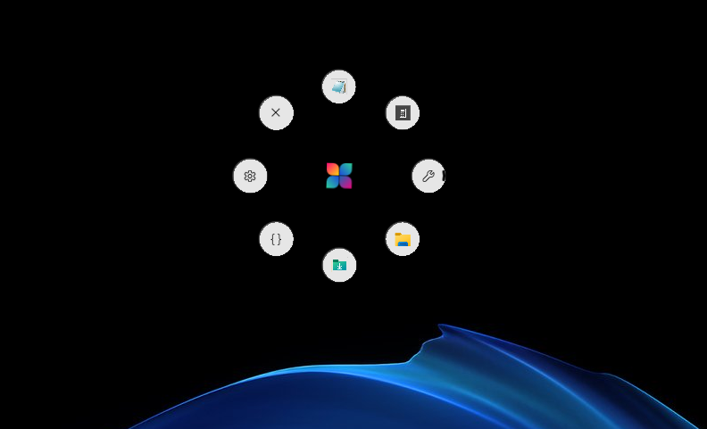
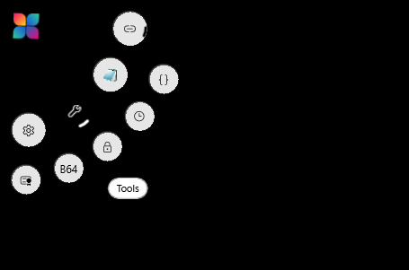
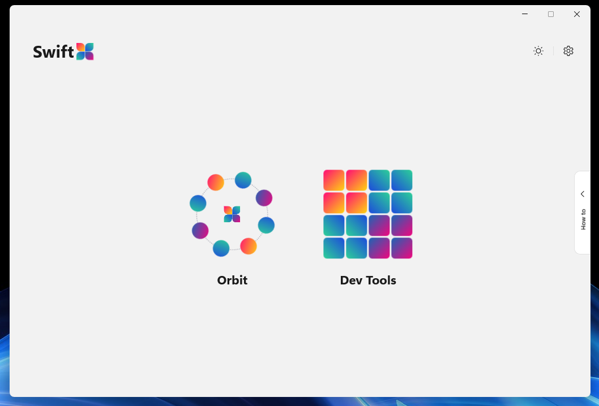
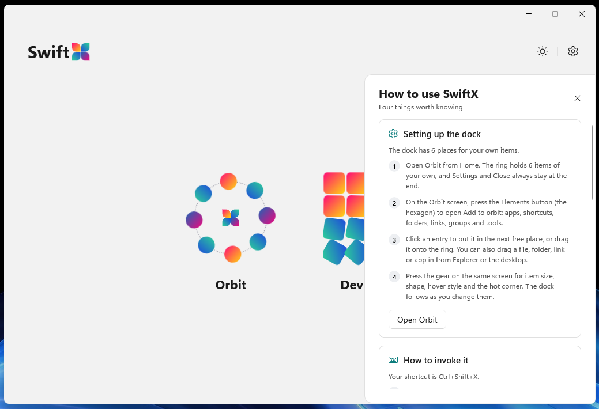
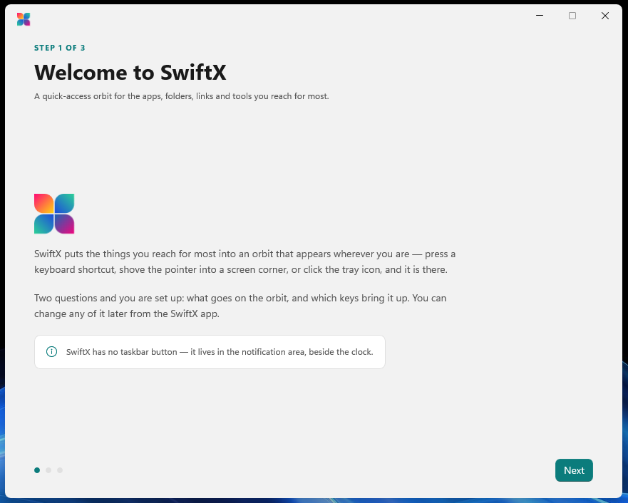
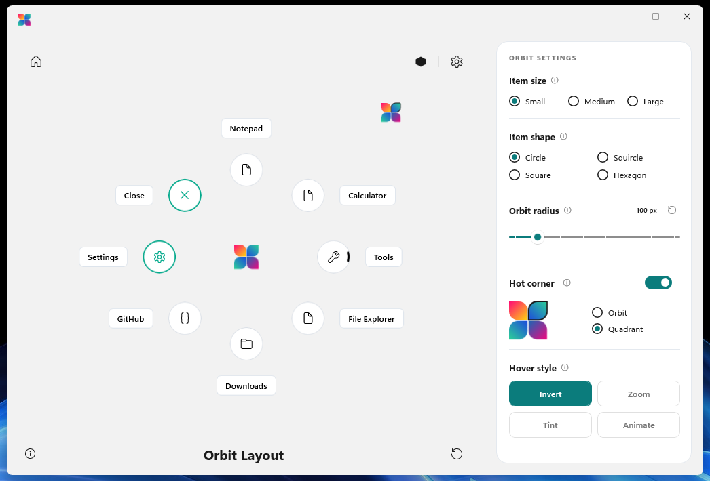
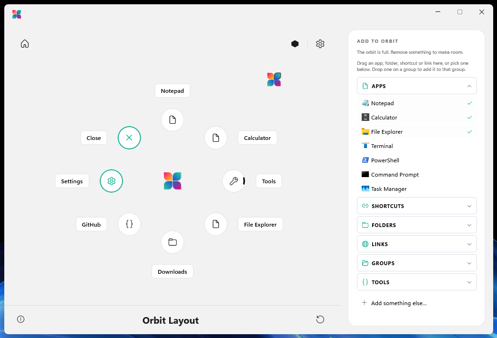
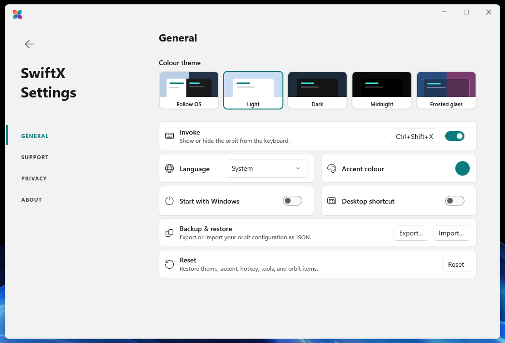
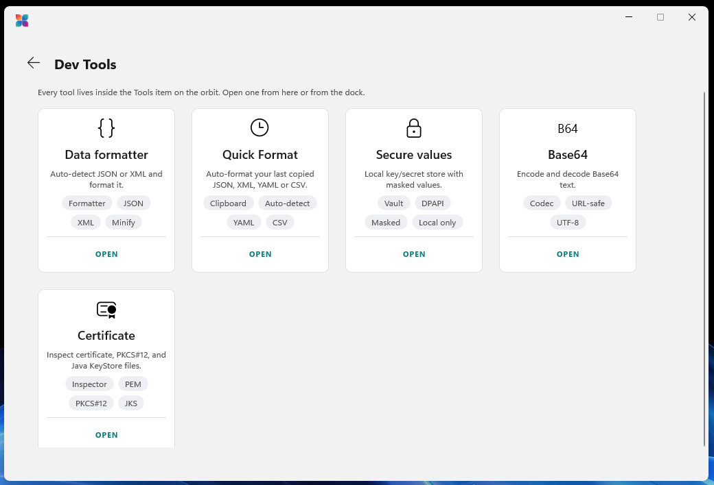

<p align="center">
  
</p>

<h1 align="center">SwiftX</h1>

<p align="center"><b>A quick-access radial orbit for Windows 11.</b></p>

Summon it with a keyboard shortcut, a screen corner, or the tray icon; launch apps, files, folders
and links from it; pop groups open into an outer orbit; and reach a set of built-in developer tools
(JSON/XML formatter, local secure values, Base64, certificate inspector) without leaving it.

Everything runs on your own machine. There is no account, no telemetry, and nothing is uploaded.

<p align="center">
  
  <br><sub><em>The orbit, summoned over the desktop — items on eight slots around a floating hub.</em></sub>
</p>

More screenshots are spread through the sections below, next to what they show.

---

## Contents

- [Requirements](#requirements)
- [Build, test, run](#build-test-run)
- [The orbit at a glance](#the-orbit-at-a-glance)
- [Summoning the orbit](#summoning-the-orbit)
  - [Keyboard](#keyboard)
  - [Tray icon](#tray-icon)
  - [Hot corner](#hot-corner)
- [Using the orbit](#using-the-orbit)
- [The corner quadrant](#the-corner-quadrant)
- [Settings](#settings)
  - [Home](#home)
  - [General](#general)
  - [Apps & links](#apps--links)
  - [Tools](#tools-page)
  - [Feedback & Support](#feedback--support)
  - [About](#about)
  - [Privacy](#privacy)
- [Built-in tools](#built-in-tools)
- [Configuration file](#configuration-file)
- [How it works](#how-it-works)
- [Tests](#tests)
- [Theme](#theme)
- [Language](#language)
- [Brand and assets](#brand-and-assets)
- [Packaging for the Microsoft Store](#packaging-for-the-microsoft-store)
- [Troubleshooting](#troubleshooting)
- [Roadmap](#roadmap)

---

## Requirements

- Windows 10 1809+ / Windows 11
- [.NET 10 SDK](https://dotnet.microsoft.com/download)
- x64 or ARM64

## Build, test, run

```bash
dotnet build src/SwiftX/SwiftX.csproj -p:Platform=x64
dotnet test  tests/SwiftX.Tests/SwiftX.Tests.csproj -p:Platform=x64
dotnet run   --project src/SwiftX/SwiftX.csproj -p:Platform=x64
```

Substitute `-p:Platform=ARM64` on ARM hardware. Or launch the built `SwiftX.exe` from
`bin\x64\Debug\net10.0-windows10.0.26100.0\win-x64\`.

Only one SwiftX runs at a time per data directory: a second launch notices the first and exits
rather than starting a rival tray icon and hotkey. The lock is keyed to the data directory, so a
test instance pointed at a different `SWIFTX_DATA_DIR` can run alongside your real one.

---

## The orbit at a glance

The orbit is a **transparent, always-on-top overlay** the size of the monitor's work area. Only the
items themselves take input; every other pixel of that window is click-through, so the orbit can
cover the screen without getting in the way of it.

| Piece | What it is |
|-------|------------|
| **Hub** | The app mark at the center, floating on a soft drop shadow rather than sitting flat on the wallpaper. Not a button for launching — clicking it closes an open group, or dismisses the orbit when none is open. Fixed size; no setting scales it. It turns a quarter turn as the orbit is summoned, its four petals unfurling clockwise a beat apart, and unwinds the same way on dismissal. |
| **Slots** | Eight positions around the orbit, 45° apart, slot 0 straight up and advancing clockwise. |
| **User slots** | The first six. Filled from your items in order; empty ones are simply not drawn. |
| **Settings** | Always slot 7. A group: hovering it pops out its **Add new** quick action; clicking it opens the SwiftX app window. |
| **Close** | Always slot 8. Quits SwiftX. It shrinks rather than grows under the pointer, so it never reads as an invitation. |
| **Tools** | One of the six user slots by default — a single group holding every built-in tool. |
| **Flyout** | A group opens into a *concentric outer orbit* around the one already on screen, up to eight children. The inner orbit never moves, so you keep your bearings. |

Item kinds: **Application**, **File**, **Folder**, **Web link**, **Shortcut** (.lnk), **Group**,
and **Tool**. Icons come from the shell (matching Explorer, including .lnk overlays), from a web
link's own site icon, or from a Segoe Fluent glyph you pick.

---

## Summoning the orbit

### Keyboard

`Ctrl+Shift+X` by default; press again to dismiss. Remap it in **Settings → General → Invoke** by
clicking the capture button and pressing the combination you want.

- A shortcut must include **Ctrl, Alt, or Win** — Shift alone is not enough for a system-wide key.
- Windows refuses combinations another application already owns. When that happens, the Invoke card
  says so instead of failing silently, and the old shortcut stays live until a working one is set.
- The switch beside the capture button turns the shortcut off entirely without forgetting it.

### Tray icon

- **Left-click** — summon or dismiss.
- **Right-click** — Show/Hide orbit · Add item… · Settings · Quit.

"Hide orbit" is a deliberate off switch: while hidden, neither the hotkey nor the hot corner brings
the orbit back until you show it again.

### Hot corner

macOS-style, and on by default at the **top-left**. Push the pointer into the corner of the screen
and hold it there for a moment; the orbit appears without a click.

How it behaves, and why:

| Behavior | Detail |
|----------|--------|
| **Trigger patch** | A 6-pixel square at the very corner of the display. The pointer stops dead against the screen edge when you throw it at a corner, so a few pixels is all it ever needs — anything larger starts catching deliberate travel past the corner. |
| **Dwell** | The pointer must stay in the patch for **250 ms**. A corner clipped in passing does not count. |
| **Re-arm** | Having fired, it will not fire again until the pointer leaves the patch — parking the mouse in the corner summons once, not twenty times a second. |
| **Drag guard** | While any mouse button is held, the dwell does not even start. Dragging a window into a corner still hits Windows' own snap, and a text selection that ends in a corner is not a summon. |
| **Per monitor** | The corner belongs to whichever display the pointer is on, measured against that display's full bounds rather than its work area — the corner of the *screen* is where the pointer actually stops, taskbar or not. |
| **A toggle** | Reaching the corner while the orbit is already open puts it away rather than summoning a second time — the same toggle the hotkey and the tray icon already are. Parking the mouse back in the corner is a reliable way to dismiss it however it was opened. |
| **Hidden** | "Hide orbit" from the tray is honored — unlike a keypress, a pointer can wander into a corner without being asked to. |
| **Detection** | The pointer is polled every 50 ms on a `WM_TIMER`, riding the same hidden message window the tray icon and hotkeys already use. No system-wide mouse hook is installed for this. |

Pick the corner and what it opens in **Settings → Home → Hot corner**: a switch, a corner
dropdown, and two choices for the shape —

- **Orbit** (default) — the whole orbit, drawn at the corner.
- **Quadrant** — four items only, on a quarter circle centered on the corner itself: QuickAccess,
  Notepad, Tools, and Settings by default (see [The corner quadrant](#the-corner-quadrant)).

<p align="center">
  
  <br><sub><em>The top-left corner fired, drawing the whole orbit anchored to that corner instead of
  the screen's center.</em></sub>
</p>

---

## Using the orbit

| Action | Result |
|--------|--------|
| **Hover** an item | Its full name pops out in a pill beside it, along the same radial the item sits on, so the label never covers the item — always in exactly one place, even for a group whose flyout is open. |
| **Hover** a group | After a short dwell it opens into the outer orbit. Sweeping past on the way to a neighbour does not fire it. Its own label stays put beside the group — it never relocates to a heading above the arc, on the full orbit or a quadrant alike. |
| **Click** a leaf | Launches it and dismisses the orbit. Settings and Add-new are the exceptions: they open their own window and leave the orbit up. |
| **Click** a group | Opens it (never toggles it shut — that would make groups flicker under a normal point-and-click). |
| **Click** the gaps | The whole disc is live: a click between two items activates whichever one the pointer is angularly nearest, exactly as clicking the item would. Nothing hovered — a gap with no item in it, or empty space past an open flyout's arc — dismisses the orbit instead. |
| **Click** the hub / dead zone | Dismisses the orbit, closing any open flyout along with it. |
| **Esc** | Closes an open group first, then the orbit. |
| **Click anywhere else** | Dismisses. The click reaches whatever is under it — the orbit is not covering the screen for input purposes. |

A group wears a short arc on its outward edge, so an item that opens an orbit of its own can be told
from one that launches before you touch it.

---

## The corner quadrant

With **Quadrant** selected, the hot corner puts four items on a quarter circle whose center is the
corner of the screen itself. The pointer is already there, so every item is a short flick away.

**The geometry** adapts rather than being fixed. Two things have to hold at once — neighbouring
items must not touch, and the first and last must clear the two screen edges the corner is made of
— and both depend on the radius. So the arc starts at the orbit's own radius and grows only as far
as it must, which is what keeps the layout correct at any item size and any radius you have set.
Items are then spread evenly across whatever the edge clearance leaves.

**The four items**, until you say otherwise, are:

1. **QuickAccess** — every web link and shortcut on your orbit, gathered into one group, wherever
   they sit (top level or nested inside your own groups). Drops out entirely if you have none, so
   an empty group never takes a place for nothing.
2. **Notepad** — your orbit's own Notepad if it has one, or the same default `SeedDefaults` plants
   on a fresh orbit otherwise, so this place always opens to something.
3. **Tools**
4. **Settings**

— content first, built-ins last, the same convention the full orbit reads in with Settings and
Close pinned to its own last two slots. Close is deliberately absent from the quadrant: there are
only four places, and it is dismissed the way the orbit always was (Esc, a click elsewhere, or the
corner itself again). QuickAccess stays live even after you have arranged the corner by hand — a
link you add to the orbit later still joins it — and so does Tools, following the Tools page's
switches the same way it does on the full orbit.

**Editing the corner** happens on the Home page's canvas (see below). Until you touch it, the
corner has nothing stored and simply follows the rules above — add a link to the orbit and
QuickAccess picks it up. Your first edit writes the current selection into the config, and from
then on the corner is your own arrangement; any of the four can be swapped for anything else.

Groups still work inside a quadrant: expanding one fans its children out into an outer arc, slid
back inside the quarter if it would otherwise throw half of them off the screen.

---

## The SwiftX app

The companion window behind the orbit's Settings item — where you customize what the orbit holds,
tweak its look, manage the built-in tools, and change app-wide settings. Reached from the orbit's
Settings item, the tray menu, or by launching SwiftX again.

The window is built on the Logi Options+ reference app in
[`framedparadox/windows-app-mx`](https://github.com/framedparadox/windows-app-mx) (branch
`logiApp/dotnet`) — its `MainPage` header supplies Home, its `SettingsPage` supplies Settings
measure for measure, and its `Settings*` colour tokens are carried into `Themes/Colors.xaml` as the
`Shell*` family. The mockups it is built to are in [`docs/images/`](docs/images); the plan behind
them is [`docs/swiftx-app-shell.md`](docs/swiftx-app-shell.md).

**Home** is a greeting header — the time of day, at 30px — with a theme-cycle button and a settings
gear on the right, over three portrait boxes:

| Box | Opens |
|-----|-------|
| **Orbit** | The live orbit customizer: arrange the orbit, set its size, radius, hover style and hot corner |
| **Tools** | The built-in developer tools, and which of them show on the orbit |
| **Elements** | The apps, files, folders, links and groups on the orbit |

<p align="center">
  
  <br><sub><em>Home, with its two main boxes open onto the orbit customizer and the built-in tools.</em></sub>
</p>

A slim tab on Home's right edge, halfway down, opens a **How to** guide: a drawer that slides over
the Home screen with four topics (setting up the dock, how to invoke it, how to use the hot corner,
how to change items). It is written from your own configuration, so it names the shortcut and the
corner you actually chose and says so plainly when either is switched off, and each topic has a
button that goes to the place it describes. The topics are one scrolling list, and nothing dims the
Home screen behind it. Esc or the close button closes it.

<p align="center">
  
  <br><sub><em>The How to drawer, mid-slide over Home — each topic links straight to the screen it explains.</em></sub>
</p>

The gear opens **Settings**, which is a screen of its own rather than the window itself: a 270px
rail with four sections — General, Feedback & Support, Privacy & Data, About. Every sub-screen has
a back arrow that returns to Home.

### First run

The first launch on a machine opens a three-step set-up guide instead of the app window: a welcome,
a picker for what goes on the orbit (stock Windows apps, your own folders, a couple of links, the
built-in tools, plus **Add your own…** for anything else), and the keyboard shortcut and hot corner
that summon it — along with *Start with Windows* and *Desktop shortcut*.

<p align="center">
  
  <br><sub><em>Step 1 of 3 — the welcome step. Steps 2 and 3 pick the orbit's starting items and the
  shortcut/hot corner that summon it.</em></sub>
</p>

Nothing is written until **Finish**. Dismissing the guide leaves the orbit exactly as it shipped,
because the default six items are seeded before the guide opens and the guide only ever replaces
them; its own tick-boxes start on that same six, so finishing without touching anything is a no-op.
Re-run it any time from **Settings → General → Set-up guide**.

### Orbit

The screen behind Home's **Orbit** box: a live preview of your orbit on the left, and a sidebar on
the right that either edits its settings or adds items to it. It is Logi's `ActionRingPage` layout
view, built to [`docs/images/17-app-ring.svg`](docs/images/17-app-ring.svg): a canvas column — a
68px header, the ring, a 60px toolbar over a hairline — beside a fixed 320px sidebar, in the ring
canvas's own darker palette rather than the app chrome's (see
[`docs/full-app-mockups-logi-base.md`](docs/full-app-mockups-logi-base.md) for why those are two
palettes and not one). What it shows is what the orbit draws, at the current size and radius.

<p align="center">
  
  <br><sub><em>The canvas with the sidebar's default panel: item size, shape, radius, hot corner and
  hover style, all live against the preview on the left.</em></sub>
</p>

**The canvas**

- **Click an empty slot** (or its `+`) to add an item there.
- **Click an item** for a details card anchored where you clicked: its kind, its name, what it
  points at, and its icon — with a pencil that opens a glyph picker, a **Use a picture…** entry for
  your own image, and a **Reset** that hands the icon back to whatever the target resolves to.
  Clicking the same item again closes the card.
- **Click a group** and the canvas becomes that group: its own mark at the centre and its children
  fanned on an arc around it, at the same bubble size and angular spacing the real orbit opens a
  group with. The toolbar's **Orbit Layout** title gives way to that group's name while it is open,
  and the header's Home button stays put as on every other screen. The way out is the group's own
  mark at the centre: it turns into a close mark under the pointer, and a click returns to the
  whole orbit. A dashed slot at each end of the arc adds to the group.
- **Drag an item** to another slot to rearrange. A drop lands on the nearest slot, even out past
  the bubbles — the intent is the nearest place, not a pixel-perfect landing.
- **Right-click an item** for **Replace…** and **Delete**. Replace opens the same form the `+`
  does and puts what you add into that same slot; a group goes with its children either way. The
  built-in tools are the Tools page's — right-clicking one offers nothing, since a tool leaves the
  orbit by being switched off there.
- **Add item… / Reset defaults** sit at the right of the toolbar along the bottom, where Logi puts
  its own tools bar. They are hidden inside a group: both act on the top-level orbit, and a Reset
  that reads as scoped to the group you are looking at would be the wrong kind of surprise.
- **A gear and a wrench** sit at the left of that toolbar — Settings, and a help menu. The menu is
  the reference's How To / Support / What's New, re-pointed at things this app actually has: the
  set-up guide, the Edit panel, the README, the issue tracker and the releases page.

Each filled slot wears an outward **name pill** — Logi's own 30px, 6-corner, 12px SemiBold pill,
placed by Logi's own rule rather than a polar formula: the top and bottom slots take theirs above
and below, the other six out to the side. They are drawn on a second canvas behind the bubbles with
hit-testing off, which is what lets a pill overlap a node without ever becoming a drag target; they
hide for the duration of a drag, since they do not follow a bubble, and come back on the drop. A
name takes a drop exactly as its icon does: drag something from the Edit panel, or in from Explorer
or a browser, onto the name and it lands in that item's slot.
Nothing is drawn under them: like Logi's, the ring is implied by where its nodes sit.

**The sidebar** has two modes, and the **Edit** button in the header swaps between them. This is
where the screen departs from Logi deliberately: Logi's sidebar is only ever its drag-source
accordion, and its ring settings are a separate screen behind a nav button. SwiftX has one screen
for the orbit, so the sidebar is what changes.

By default it is the orbit's own settings — Item size, Item shape, Orbit radius, Hot corner and
Hover style. Pressing **Edit** swaps it for **Apps /
Shortcuts / Links / Tools**, an accordion of things that can go on the orbit: the apps, folders and
links this machine actually has (the same existence-checked catalog the first-run guide offers
from) and the built-in tools. Click a row to put it in the first free slot; anything already on the
orbit is shown ticked and does nothing. **Add to Orbit…** at the bottom opens the full add
dialog. The swap is a visibility change between two panels, not a navigation, so the canvas keeps
its selection and its drag state across it.

<p align="center">
  
  <br><sub><em>The same canvas after pressing Edit — the sidebar becomes the Apps/Shortcuts/Folders/
  Links/Groups/Tools accordion, with what's already on the orbit ticked off.</em></sub>
</p>

**Size** — Small / Medium / Large, on one row. Scales the items around the orbit; the hub is
unaffected.

**Shape** — Circle, Squircle or Square. A separate axis from size: how much room an item takes is
one question, what fills it is another. One place turns the setting into geometry
(`OrbitMetrics.CornerRadiusFor`), expressed as a fraction of the bubble rather than a fixed corner,
so the orbit, its flyout band, the corner quadrant and this preview cannot drift into drawing three
different shapes from one setting.

**Radius** — 80–220 px from the hub to each item's center.

**Hover style** — **Invert**, **Zoom**, **Tint** or **Animate**: how an item reads as under the pointer. Invert
swaps its fill to the opposite theme color and grows it slightly. **Zoom** keeps the fill and changes
only the size, **Tint** keeps the size and fills the item with a color you choose, and **Animate** plays a motion while the pointer is on the item. Zoom, Tint and Animate
are split buttons: unselected they are a single pill, and selecting one splits it into two adjoining
pills, the option's own name on the left (70%) and its setting on the right (30%).

- **Zoom** — the right pill reads **In** (the item grows, the default) or **Out** (it shrinks);
  pressing it flips between them. The left part keeps Zoom selected and does nothing more.
- **Tint** — the right pill is a swatch of the current hover color, black by default. Pressing it
  opens a color picker with a **Reset to default** button; the choice applies to the orbit as you
  drag. The glyph on the tinted item is black or white, whichever contrasts better with the color
  picked, so any color stays readable. Under High Contrast the chosen color is not applied and Tint
  behaves as Invert, so an item never gives no sign at all that it is under the pointer.
- **Animate** - the right pill shows the symbol of the chosen motion; pressing it opens a picker of
  six: **Pulse** (the default), **Bounce**, **Wobble**, **Shake**, **Spin** (one full turn) and
  **Float**. Hovering an option in the picker plays that motion on its symbol, so the choice can be
  seen from Settings. The motion repeats for as long as the pointer stays on the item, then the item
  glides back to rest. With animations switched off in Windows, Animate behaves as Zoom.

Close goes red under the pointer whichever style is set.

**Hot corner** — one section, two rows:

- Row 1: the switch.
- Row 2: which corner, and whether it opens the **Orbit** or a **Quadrant**. Both go dead when the
  switch is off rather than disappearing and shuffling the column.

**The corner button on the canvas** appears whenever the hot corner is on, in the canvas corner
matching the one you picked. It switches the canvas between the orbit and *what that corner opens* —
drawn to the same rules and at the same scale, so the two views differ in shape, not size. In that
view the corner is editable:

- **Drag** one place onto another to reorder.
- **Click the empty place** (the `+`) to add — the item belongs to the corner, not the orbit.
- **Right-click an item** for **Replace…** and **Remove from corner**. The orbit keeps whatever you
  take off. On the last item Remove is greyed out — a corner with nothing on it would summon an
  empty screen.

Nothing else is drawn: no guide arc through the places, and no remove badge pinned to every item.

"Reset defaults" clears your corner arrangement along with the orbit, putting the corner back to
following it.

### Settings → General

App-wide preferences — theme, accent colour, language, the summon shortcut, and startup — reached
from Home's gear icon.

<p align="center">
  
  <br><sub><em>Settings → General: the five theme cards, accent colour, language, and the Invoke
  shortcut card.</em></sub>
</p>

| Setting | What it does |
|---------|--------------|
| **Theme** | Light, Dark, **Midnight**, **Frosted glass**, or System — five preview cards in Logi's own 145x130 geometry, not a dropdown. Dark is layered dark plates over the window's Mica; Midnight replaces them with one flat near-black; Frosted glass drops them to a low-alpha wash over a real acrylic so the desktop reads through the window; Light is opaque. The orbit's own bubbles are live acrylic in every theme. See [Theme](#theme). |
| **Accent colour** | A swatch and colour picker, directly under Theme. Defaults to Logi's violet (`#8A67FF` dark / `#6C47FF` light) and colours the app window's toggles, radio buttons, the Radius slider, the rating stars, the Settings rail and the selected theme card, plus the Feedback links. **Reset to default** sits in the picker's flyout. |
| **Language** | 19 languages plus System (follows Windows). The tool windows (Data Formatter, Secure values, Base64, Certificate) and the tray menu pick it up the next time they open; everything else applies on restart. Right-to-left languages (Arabic, Hebrew) mirror the tool windows' layout. See [Language](#language) for the full list. |
| **Invoke** | The summon shortcut, its capture button, and an on/off switch. Reports whether Windows accepted the combination. |
| **Start with Windows** | Per-user autostart. Unpackaged builds use the `HKCU\...\Run` key (no elevation); the MSIX build uses a declared startup task, so Windows lists it in Task Manager's Startup tab and honors a user override there. |
| **Backup & restore** | Export the whole configuration to JSON, or import one back. |
| **Reset** | Restores theme, accent colour, hover style, item size, radius, shortcut, hot corner, tools, and orbit items to defaults. |
| **Set-up guide** | Re-runs the first-run guide against the orbit as it stands. It writes nothing unless you press Finish. |

**Hover style** moved out of General to the Orbit Settings screen, beside size and radius — it is a
property of the orbit, not of the app.

### Elements

A card per orbit item — show/hide each one, edit it, or delete it. Groups are listed with their
children beneath them. **Edit** reopens the add dialog on the item as it already is, carrying its
id, its hidden state and the fields the form has no box for (arguments, a custom icon) across the
save, so an edit really does edit rather than replace. Built-in tools are not listed here (the Tools page owns them), and neither
are Settings and Close, which the orbit always draws itself.

Its own **Add item…** button opens the same dialog as the orbit's "Add to orbit" quick action, but
titled "Add item" and without the Tool tile — a built-in tool already has its own home on the
Tools page, so that tile only makes sense from an orbit or corner slot that can actually hold one.

### Tools

The screen behind Home's **Dev Tools** box: one card per built-in tool, describing what it does,
with a switch that puts it in the orbit's Tools item or takes it out, and an open button. The cards
do not reorder — the order is the catalog's, and a tool's place inside the Tools group was never
something worth dragging for.

<p align="center">
  
  <br><sub><em>Every built-in tool — Data formatter, Quick Format, Secure values, Base64 and
  Certificate — each with its own open button.</em></sub>
</p>

### Settings → Feedback & Support

Three cards — general feedback, a star rating, and issue reporting — each with a link that opens in
your browser. SwiftX sends nothing on its own: the stars are stored locally as `FeedbackRating` and
never leave the device, so the links are the only thing that actually reaches anyone. Its links and
stars are the most visible place the [accent colour](#accent-colour) shows up.

### Settings → About

Logi's own two-card About: a hero card with the app mark at 72px, the name, the version and what
the app is, plus links to the terms and conditions (which open in the browser) and to Privacy &
Data; then a spec card — Windows build, UI framework, managed runtime, and whether this is the MSIX
or the portable build. Every value in it is read at runtime rather than written into the markup.

### Settings → Privacy & Data

What happens to what you put into SwiftX, in plain terms: everything stays on the device, no
tracking or analytics, secure values encrypted for your account, the tools running offline, the one
thing that touches the network, and how to export or reset your data.

---

## Built-in tools

All four run entirely on this machine. Nothing you paste or open is uploaded.

By default tool windows are **reused** — opening a tool a second time brings the existing window
forward rather than stacking another one up (`ReuseToolWindows` in the config file).

### Data Formatter

Auto-detects and works with **JSON and XML**.

- Basic bar: **Format**, **Validate** (clean + pretty-print), **Copy**, **Clear**, **Save**.
- Pasting into the editor formats and detects the type immediately — not just on the debounced
  keystroke-by-keystroke detection that typing gets.
- Advanced sidebar: **Minify**, **Sort keys**, **Escape/Unescape**, **Convert to JSON/XML**, and
  indent width.
- XML parsing is hardened against the usual entity-expansion and external-entity traps.

### Secure values

A local key/secret store. Values are masked in the list, copy to the clipboard on demand, and are
protected with Windows' own per-user encryption (DPAPI) — readable only while signed in to that
account on that device.

### Base64

Encode and decode text, with a URL-safe alphabet option, and encode a file's bytes directly.

### Certificate

Inspects `.cer` / `.crt` / `.der` / `.pem`, PKCS#7 bundles, password-protected PKCS#12/PFX, and Java
KeyStore (`.jks`) files, showing full field detail for every certificate in the file.

---

## Configuration file

Stored at `%AppData%\SwiftX\orbit.json`. Set `SWIFTX_DATA_DIR` to put it (and the icon cache)
somewhere else — useful for a portable install or for running a test instance beside your real one,
since the single-instance lock is keyed to the data directory too.

Writes are atomic (written to a temporary file, then moved into place), and a config that fails to
parse falls back to defaults rather than taking the app down with it.

### Upgrading from a pre-rename build

Builds from before the orbit was called an orbit wrote `%AppData%\SwiftX\ring.json`, with `Rings`,
`RingRadius` and `HotCornerRing` as key names and `"Ring"` as a `HotCornerLayout` value. Those names
crossed the persistence boundary, so the rename could not simply be a rename: the three keys would
have deserialized into nothing (silently discarding every item you had arranged), and the enum value
would have *thrown*, which `Load` catches by falling back to a blank config. Losing a whole dock on
upgrade is the failure this path exists to prevent.

`ring.json` is read **only** when `orbit.json` does not exist. `Services/LegacyConfigFormat.cs` maps
the old file forward as a pass over the JSON itself, before deserializing — it has to be, because
`JsonStringEnumConverter` throws on the stale `"Ring"` value before any property setter could fix
it, and keeping the shim out of `AppConfig` means the model reads as the shape the app has today:

| Old | New |
|-----|-----|
| `Rings` | `Orbits` |
| `RingRadius` | `OrbitRadius` |
| `HotCornerRing` | `HotCornerOrbit` |
| `HotCornerLayout: "Ring"` | `HotCornerLayout: "Orbit"` |

A file already carrying the current name wins outright — the legacy key is dropped rather than
allowed to overwrite it — so a hand-edited config holding both cannot end up with the older of the
two. Anything malformed is handed straight back unchanged, leaving `Load`'s own deserialize as the
single place a bad config is diagnosed. A config with nothing to map is returned as-is, so the
cost on every normal launch is one parse and four key probes on a file that is kilobytes.

`ring.json` is never written to. The first save after the upgrade lands on `orbit.json` and the old
file is left exactly where it was from then on, so downgrading still finds the configuration it had.
The same forward-mapping runs on **Backup & restore** import, since a configuration exported by a
pre-rename build is a file you can still pick.

### Top-level keys

| Key | Type | Default | Meaning |
|-----|------|---------|---------|
| `Orbits` | array | one profile | Orbit profiles. Only the first is used today; it holds your items. |
| `LaunchAtStartup` | bool | `false` | Mirrors the "Start with Windows" switch. |
| `Theme` | `Light`/`Dark`/`Black`/`FrostedGlass`/`System` | `Dark` | Window and orbit theme. `Black` is the one shown in Settings as **Midnight** — the enum member keeps its original name because it is persisted by name, and renaming it would strand configs that already carry `"Black"`. `FrostedGlass` is shown as **Frosted glass**. |
| `FrostedGlass` | `Light`/`Medium`/`Dark` | `Light` | How much frost the **Frosted glass** theme uses. Read only while `Theme` is `FrostedGlass`, but kept either way so switching away and back returns the frost you had. |
| `AccentColorHex` | `"#RRGGBB"` or null | `null` | The app's accent colour. `null` means the built-in violet for the theme in play. Anything that doesn't parse falls back the same way. |
| `Language` | `System`/`EnglishUS`/`EnglishUK`/`French`/`German`/`Spanish`/`Italian`/`PortugueseBR`/`PortuguesePT`/`Dutch`/`Polish`/`Turkish`/`Russian`/`Arabic`/`Hebrew`/`Hindi`/`Japanese`/`ChineseSimplified`/`ChineseTraditional`/`Korean` | `System` | UI language. `System` follows Windows' own UI language, falling back to English (US). |
| `HoverStyle` | `Invert`/`Zoom`/`Tint`/`Animate` | `Invert` | How an orbit item reacts to the pointer: `Invert` swaps to the opposite color and grows, `Zoom` keeps its color and changes size (see `HoverZoomDirection`), `Tint` keeps its size and fills with `HoverTintColorHex`, `Animate` plays the motion `HoverAnimation` names. An unknown name reads as `Invert` rather than discarding the config. |
| `HoverZoomDirection` | `In`/`Out` | `In` | Which way `Zoom` moves an item — `In` grows it, `Out` shrinks it. Read only while `HoverStyle` is `Zoom`, but kept either way. An unknown name reads as `In`. |
| `HoverTintColorHex` | `"#RRGGBB"` or null | `null` | The fill `Tint` paints under the pointer. `null` means black. Anything that doesn't parse falls back the same way. |
| `HoverAnimation` | `Pulse`/`Bounce`/`Wobble`/`Shake`/`Spin`/`Float` | `Pulse` | The motion `Animate` plays. Read only while `HoverStyle` is `Animate`, but kept either way. An unknown name reads as `Pulse` rather than discarding the config. |
| `Hotkey` | string | `"Ctrl+Shift+X"` | Summon shortcut, in readable form so a hand-edited file stays legible. |
| `HotkeyEnabled` | bool | `true` | Whether the shortcut is registered at all. |
| `HotCornerEnabled` | bool | `true` | Whether a screen corner summons the orbit. |
| `HotCorner` | `TopLeft`/`TopRight`/`BottomLeft`/`BottomRight` | `TopLeft` | Which corner. |
| `HotCornerLayout` | `Orbit`/`Quadrant` | `Orbit` | Whether that corner opens the whole orbit or the quarter circle. |
| `HotCornerOrbit` | array | empty | Your corner arrangement. Empty means "follow the orbit" — see below. |
| `ItemShape` | `Circle`/`Squircle`/`Square` | `Circle` | The outline orbit items are drawn with. |
| `ItemSize` | `Small`/`Medium`/`Large` | `Medium` | How large orbit items are drawn. |
| `OrbitRadius` | number or null | `null` (100) | Distance from hub to item centers, 80–220. |
| `ShowDataTool` | bool | `true` | Data Formatter in the orbit's Tools item. |
| `ShowSecureValuesTool` | bool | `true` | Secure values in the Tools item. |
| `ShowBase64Tool` | bool | `true` | Base64 in the Tools item. |
| `ShowCertificateTool` | bool | `true` | Certificate in the Tools item. |
| `ReuseToolWindows` | bool | `true` | Reopening a tool reuses its window. No UI switch; config only. |
| `FeedbackRating` | number | `0` | The stars set on the Feedback & Support page. Stored here and nowhere else — it is never sent anywhere. |
| `Seeded` | bool | — | Set once, after the first run has planted the default items. |

### Orbit items

Each entry in `Orbits[0].Items` (and in a group's `Children`, and in `HotCornerOrbit`):

| Field | Meaning |
|-------|---------|
| `Id` | Stable identity. `HotCornerOrbit` entries are matched back to orbit items by this. |
| `Kind` | `Application`, `File`, `Folder`, `WebLink`, `Shortcut`, `Group`, or `Tool`. |
| `DisplayName` | The label in the hover pill. |
| `Target` | Path, URL, or tool name (`Data`, `SecureValues`, `Base64`, `Certificate`). Groups may carry a marker target — the Tools group uses `swiftx:toolsgroup`. |
| `Arguments` | Command-line arguments, for the kinds that launch something. |
| `CustomIconPath` | An icon file to use instead of the resolved one. |
| `CustomGlyph` | A Segoe Fluent codepoint (or short text such as `B64`) to draw instead of an icon. |
| `Hidden` | Kept in the config but not drawn. The Tools page's switches work by setting this. |
| `Children` | A group's items. |

Settings, Close and Add-new are **never** stored — the orbit synthesizes them at render time, which
is why they cannot be reordered, hidden, or deleted, and why they never appear in Apps & links. A
config written by an older build that did store them is repaired on load.

### How `HotCornerOrbit` resolves

Empty means the corner follows the orbit: the four places are QuickAccess (every web link and
shortcut on the orbit, gathered into one group), Notepad (the orbit's own, or a default stand-in),
Tools, and Settings, recomputed every time. Once you arrange the corner by hand the list is
written out, and each entry is mapped back to the live thing it names before it is drawn —
Settings to the synthesized entry, `swiftx:toolsgroup` to the Tools item on the orbit (so the Tools
page's switches still govern its children), `swiftx:quickaccess` to a freshly gathered QuickAccess
group (so it too keeps up with new links and shortcuts after being locked into an arrangement),
everything else to the orbit item with the same `Id`. An entry naming something that has since left
the orbit — including a QuickAccess with nothing left to gather, or a Notepad the orbit never really
had — keeps working from its own stored copy, which is what lets the corner hold an item the orbit
itself does not.

### Migrations run at startup

1. Stored Settings/Close entries from older builds are stripped.
2. Orbit items pointing at the retired `Json` / `Xml` tool targets are rewritten to `Data`, and the
   duplicates that creates are collapsed.
3. **Tools are gathered into one group.** The group is found by its marker target first and by name
   second (which adopts the "Dev tools" group earlier builds seeded), tools from the top level and
   from other groups are moved in, duplicate kinds are dropped, and any built-in tool the orbit had
   no item for is added. A group created by this step takes the orbit slot of the first tool it
   absorbed. An orbit with no tools *and* no group is left alone — deleting them should not undo
   itself on the next launch.
4. Every tool item's `Hidden` flag is re-pointed at the Tools page's switches.

The config is re-saved only when one of these actually changed something.

---

## How it works

```
src/SwiftX/
  App.xaml.cs              Startup, single-instance lock, unhandled-exception guard
  OrbitManager.cs           Owns config, tray, hotkey, hot corner, windows, activation
  OrbitWindow.xaml(.cs)     The orbit itself: layout, animation, hover, flyout, input
  ShellWindow.xaml(.cs)    The SwiftX app window: Home, Orbit, Tools, Elements, Settings
  OnboardingWindow.xaml(.cs) The first-run set-up guide
  AddItemWindow.xaml(.cs)  "Add to orbit" / "Add item", including drag-and-drop from Explorer

  Models/
    AppConfig.cs           Persisted settings
    OrbitItem.cs            One orbit entry
    OrbitProfile.cs         One orbit's items
    OrbitMetrics.cs         All orbit geometry, as one set of derived numbers
    SystemOrbitItems.cs     Settings / Close / Add-new, synthesized not stored
    ToolCatalog.cs         The built-in tools, and the Tools-group migration
    HotCorner.cs           Corner enum, layout enum, and the trigger-patch test
    QuadrantLayout.cs      The quarter circle: radius, angles, corner mapping, item pick
    HotCornerItems.cs      What the corner shows: default pick vs stored arrangement
    HotkeyGesture.cs       Parse/format a system-wide shortcut

  Services/
    MessageWindow.cs       One hidden HWND: tray callbacks, WM_HOTKEY, WM_TIMER
    HotkeyService.cs       RegisterHotKey, keyed by id
    HotCornerWatcher.cs    Pointer polling, dwell, re-arm, drag guard
    TrayIconService.cs     Notification-area icon and its native menu
    WindowChrome.cs        Borderless/transparent/hit-region window plumbing
    IconService.cs         Shell icons (jumbo), favicons, disk cache
    OrbitStore.cs           Load/save/import/export
    Launcher.cs            Starting whatever an item points at
    SecureValueStore.cs    DPAPI-protected key/secret storage
    AppLogo.cs             The SwiftX mark, as vector geometry (see Brand and assets)
    Greeting.cs            The Home screen's time-of-day line
    OnboardingCatalog.cs   What the set-up guide offers, existence-checked per machine
    Formats/, Syntax/      JSON/XML parsing, validation, tokenizing
  ToolPages/               The four tool UIs
  Controls/AppTitleBar.cs  Title bar for the app's own and the tool windows
  Interop/NativeMethods.cs The Win32 surface, grouped by what needs it

  Assets/SwiftX.ico        Executable icon; also the shell and tray icon
  Images/                  MSIX tile set

img/SwiftX.png             Master art every raster asset is generated from
TERMS.md                   Terms and conditions, linked from Settings > About
docs/                      Design standards, the Logi-based shell plan, and the mockups
notes/                     Internal design/review notes (not shipped, not linked from the app)
tools/                     One-off maintenance scripts (brand asset generation)
```

Two design notes worth knowing before changing things:

- **Geometry lives in `OrbitMetrics`.** Bands are derived from one radius through
  `FlyoutRadiusFor`, `FlyoutBandStartFor`, `ContentRadiusFor` and friends, which is what lets the
  same drawing code serve both the full orbit and the quarter circle — the quadrant just feeds in a
  different radius.
- **The overlay's hit region is real clipping.** `WindowChrome.SetEllipticHitRegions` clips DWM's
  composited pixels, not just input, so the region must bound everything painted — hover growth and
  an open flyout included, plus a second circle around the hover pill while one is showing.

---

## Tests

```bash
dotnet test tests/SwiftX.Tests/SwiftX.Tests.csproj -p:Platform=x64
```

The suite covers the parts that can be reasoned about without a window on screen:

- `Models/HotCornerZoneTests` — the trigger patch: the corner pixel of each corner, only ever one
  corner matching, mid-edge and off-display rejection, displays at a negative origin, and the clamp
  that stops an oversized patch swallowing half the screen.
- `Models/QuadrantLayoutTests` — every item wholly on screen from all four corners, no two touching,
  the round trip between corner-local and canvas angles, a radius left alone when it already fits,
  and which items the corner picks by default: QuickAccess gathering links and shortcuts from
  anywhere on the orbit (skipping hidden ones, dropping out when there's nothing to gather), and
  Notepad preferring the orbit's own over the synthesized fallback.
- `Models/HotCornerItemsTests` — following the orbit until edited, seeding on first edit, an
  arrangement surviving orbit changes, QuickAccess and Tools staying live once locked into an
  arrangement, the fallback copy for an item that left the orbit, reset, and the four-place cap.
- `Models/ToolsGroupTests` — the Tools-group migration: adoption by name, consolidation, adding a
  missing tool, slot placement, and leaving an intentionally tool-free orbit alone.
- `Models/HotkeyGestureTests`, `Models/SystemOrbitItemsTests`.
- `Formats/…` — JSON/XML formatting, validation, sanitizing, and XML security.
- `Services/…` — the round trip through `OrbitStore`, item construction, icon identity, Base64,
  the certificate and JKS readers, value masking, the display-bounds cache, and code folding.
- `Security/…` — general hardening, bounds on every input whose length a remote party or an
  opened file gets to choose, and the lifetime of a secret in memory and on the clipboard.
- `Performance/PerformanceBudgetTests` — the tool pipelines staying interactive on heavy payloads,
  and growing with the size of their input rather than its square.
- `Resilience/CrashAndHangRegressionTests`, `Load/ConcurrencyAndEnduranceTests` — malformed and
  hostile input, and sustained concurrent use.

The suite runs against a throwaway data directory, not your real one. `TestEnvironment` points
`SWIFTX_DATA_DIR` at a unique temp path from a `[ModuleInitializer]`, which has to happen before
anything reads `OrbitStore.DataDirectory` — it is a `static readonly` resolved once per process, so
a fixture or per-test setup would already be too late. This is data-loss prevention rather than
hygiene: `SecureValueStore` and `OrbitStore` both save whole-file, so a test writing through them
without the redirect would replace the running user's real store outright, with no backup.

---

## Theme

**Settings → General → Theme**, with the accent colour directly beneath it. Five choices, not
three:

| Choice | What it paints |
|--------|----------------|
| **Dark** (default) | Logi's own `#2B2B2B` page under `#333333` cards on `#444444` edges, each carrying alpha (`#D9…`, ~85%) so the app window's Mica shows through them, plus a `#202020` "tray" for the Orbit Settings screen's preview canvas. |
| **Light** | Logi's Light dictionary verbatim and fully opaque: an `#F2F2F2` page, `#FFFFFF` cards, `#E0E0E0` edges. Nothing shows through anything. |
| **Midnight** | Dark's own native chrome with every SwiftX surface replaced by one flat, near-opaque black (`#E6000000`). No raised/recessed steps — once the anchor colour is already pure black there is no lighter tone left to graduate through, so the card strokes carry the structure instead. |
| **Frosted glass** | Dark's native chrome again, but the page goes fully transparent and every plate drops to a low-alpha wash with thin white borders, over a real thin acrylic backdrop. The desktop reads *through* the window rather than around it. Comes in three frost levels — see below. |
| **System** | Follows Windows and re-themes open windows as it changes. Resolves to Light or Dark only: neither Midnight nor Frosted glass is an OS theme, so System can never land on one. |

Midnight and Frosted glass are the odd ones out under the hood. WinUI only ever resolves
`{ThemeResource}` against Light, Dark and Default, so neither can be a theme dictionary of its own.
Both ride **Dark's** `ElementTheme` (native chrome, title bar and stock controls stay dark-themed)
and are told apart at the brush level instead: `ShellWindow.ApplySurfaceOverrides` shadows the
shell's surface keys with element-local entries in the window root's own resources, and
`ThemeHelper.ColorFor`'s `AppTheme` overload answers for everything painted straight onto an element
— which is the same set of values, and has to agree with that table by hand. The `Black` enum member
keeps its name because `JsonStringEnumConverter` persists it by name, and renaming it would strand
every config that already has `"Black"` written into `orbit.json`.

#### Frost level

Frosted glass carries a **Frost** setting of its own — **Light**, **Medium**, **Dark** — shown in
Settings → General directly under the theme cards, and only while that card is the one selected.
Light is what the theme shipped as; the two above it put progressively more frost between the
window and the desktop.

| Level | Backdrop opacity | Card fill |
|-------|------------------|-----------|
| **Light** (default) | 0.65 | `#59181820` |
| **Medium** | 0.80 | `#6B181820` |
| **Dark** | 0.95 | `#7C181820` |

It is a setting beside the theme rather than three more `AppTheme` members: the theme is persisted
by name and already drawn as a card, so splitting it in three would strand every config carrying
`"FrostedGlass"` and put three near-identical cards in a row. The level lives in
`FrostedGlassBackdrop.Level` — static, app-wide state set by `OrbitManager`, the same shape
`OrbitMetrics` holds the orbit's geometry in, and for the same reason: it is read from static
colour lookups that have no config reference to carry. Changing it writes one float onto the live
acrylic controller rather than rebuilding the backdrop, which would tear down its composition
target and flicker the window.

Where Midnight's colours are a fixed table, Frosted glass's are computed: `FrostedGlassPalette`
carries the source theme's own affine alpha curves (`opacity * slope + offset`, clamped) and both
the resource override and `ThemeHelper` resolve from it, so a card painted in code and the card
beside it painted from a `{ThemeResource}` cannot disagree. Both the palette and
`FrostedGlassBackdrop` are ports of windows-app-mx's `logiApp/dotnet` branch, which is itself that
repo's port of its own `add_acrylic_frosted_theme` work.

That override is also why switching between Dark and Midnight needs a nudge. `RequestedTheme` never
changes value between the two, and WinUI only re-walks `{ThemeResource}` lookups when it does, so
`ForceThemeResourceRefresh` flips the window root to the other theme and straight back. Without it
the swap looked like it did nothing until some unrelated theme change came along later.

A `{ThemeResource}` re-resolution reaches only what is *bound*. A brush written straight onto an
element — the Elements and Tools screens build every card that way — is a local value no dictionary
can reach, so `ShellWindow.RepaintThemedContent` re-runs all of those builders on every theme change
as well. Leaving it out is what once made a theme switch look dead on those two screens while the
rest of the window moved.

### Mica — every window but the orbit overlay and the Add-item dialog

`ShellWindow`, `OnboardingWindow` and every tool window (`ToolWindowBase.ApplyBackdrop`) each attach
a real `MicaBackdrop` (`MicaKind.BaseAlt`) for every theme but Frosted glass, which gets a thin
`DesktopAcrylicController` instead (`FrostedGlassBackdrop`); `ApplyBackdrop` swaps between the two
and is guarded on the type already attached, since rebuilding a backdrop tears down its composition
target and flickers. Mica is visible only where a surface above it is translucent, which in practice
means Dark:
Dark's plates are `#D9…`, so Mica's wallpaper-derived tint reads as a subtle wash through each of
them while the four still differ enough to keep their raised/recessed hierarchy. Light's brushes are
100% opaque, so Mica is attached there too and simply never shows through anything; Midnight's flat
`#E6` black lets the barest hint through. A tool window's own page paints onto that same four-brush
family (`ShellCardBackgroundBrush`/`ShellPillBrush` for its panes, `ShellBackgroundBrush` for its
root), so Mica reads through a tool window's content exactly the same way it does the app window's.

The orbit overlay and the Add-item dialog carry no Mica. The overlay's backdrop is
`TransparentBackdrop`, which contributes no pixels of its own — attaching *a* backdrop is what stops
WinUI clearing the window to an opaque plate, so an empty one is the whole point — and the dialog is
a plain opaque surface. That split is deliberate: Settings follows a palette of its own, while
everything else — the app window and every tool window alike — keeps the app's shared black/white
identity.

### Acrylic — the orbit's own bubbles

The orbit is glass without the window being glass. Each item bubble is built (`CreateBubble`) as
stacked layers inside the one `Border` that every entrance, hover and flyout animation already
targets, so the glass travels with those animations for free:

1. A `SystemBackdropElement` carrying its own `DesktopAcrylicBackdrop`, bottom-most, sampling the
   real desktop behind the bubble.
2. A theme tint over the blur — `#66000000` in Dark, `#66FFFFFF` in Light, `#CC000000` in Midnight.
   Dark's tint is already pure black, so a higher alpha is the only thing that can tell Midnight
   apart on the orbit itself.
3. The icon or glyph, and a group's outward arc.

The acrylic disc is drawn half a pixel smaller than the tint above it (`BackdropInset`).
`SystemBackdropElement` can only round itself with a composition rounded-rect clip, whose edge is a
hard stair-step, while the tint's rounded background is drawn and antialiased by XAML — at equal
sizes the aliased disc peeks out from behind the feathered one all the way round, which is the light
rim that used to show around an inverted bubble under Light. Hover closes the same gap the other
way: an opaque fill fades the acrylic disc out along with it, since nothing shows through an opaque
circle anyway.

Hover under **Invert** swaps the tint to a fully opaque inverted fill; under **Zoom** the tint never
changes at all and the scale is the only cue (it grows for **In**, shrinks for **Out**); under **Tint**
the tint becomes the user's own opaque color and the scale does not move. An opaque tint takes the
acrylic disc out with it, as inversion does, and its glyph is black or white by the color's own
contrast rather than by theme. Close is the exception to all three and goes red
(`#EF6F6F`) in either theme. Neither the hub nor the hover pill is glass — the hub paints nothing
(the mark floats straight on the desktop on its own drop shadow) and the pill is a solid plate with
a one-pixel border.

### The light palette, inverted

Light used to be a `#F3F3F3` canvas with cards a step *lighter* at pure `#FFFFFF` — white panels
raised off grey. It is now the other way round: a pure white canvas with cards and nav pane a cool
`#F0F4F8` a step *darker*, reading as panels recessed into the page, and the Home page's orbit
preview a further step down at `#E7EDF3` so it reads as a tray sunk into the page rather than as one
more card raised off it. The card stroke was retinted to match — a cool `#DDE4EC` rather than the
old neutral `#CCCCCC` — so the card edge belongs to the same cool family as its fill instead of
cutting a grey line across it.

The cool tint is load-bearing rather than decorative. The nav pane's selected-item fills (`#DCE5EE`
/ `#D2DDE8` / `#C8D5E2`) are spelled out explicitly instead of using WinUI's own `SubtleFill*`
tokens, which the user's Windows accent personalization can influence — those tokens read "a little
bit pink" against a light pane. They used to be strictly neutral for exactly that reason; they now
carry a hue that was *chosen* rather than inherited, which keeps the problem solved without leaving
pane and canvas indistinguishable now that the canvas is pure white.

### Accent colour

**Settings → General → Accent colour**, directly under Theme — a swatch that opens a colour picker
with live preview and a **Reset to default**. Stored as `AccentColorHex`; `null` means "use the
built-in default", which is Logi's own violet: `#8A67FF` on dark surfaces and a deepened `#6C47FF`
on light ones.

SwiftX shipped a teal default before the app shell landed (`#3DDCD3` / `#0B7C7C`). The violet
replaced it when the window was rebuilt on Logi's design, and only as the *fallback* for an unset
value — a colour already stored in `AccentColorHex` is untouched, and the old teal is one click away
in the picker for anyone who wants it back.

`ApplyAccentColorOverride` paints it — always, the default included, because falling through to the
framework does not reach SwiftX's own accent at all: left unset, those brush keys resolve to WinUI's
`AccentFillColorDefaultBrush`, which is the *Windows* accent. One stored colour becomes three states
everywhere it lands: the colour itself, an 18% lighter hover, and an 18% darker pressed.

It reaches the app window's toggle switches, radio buttons, the Radius slider (track and thumb), the
Feedback section's rating stars, the Settings rail's 4px indicator and active label, the selected
theme card's border, the Home screen's box glyphs and OPEN bars, the set-up guide's step dots and
commit button, and the Feedback & Support links (`ShellWindow.ApplyAccentColorOverride`); the
Add-item dialog's own accent-tinted controls (`AddItemWindow.ApplyAccentColorOverride`); and, in
every tool window, whichever action button's hover tint isn't one of the two fixed colours below —
Open file, Format, Encode/Decode, Save, Edit, Unlock and the rest
(`EditorToolPage.ApplyHoverIconColor`, reading `AccentPalette.Resolve` directly rather than through a
resource-dictionary override, since a page built entirely in code has no dictionary for
`{ThemeResource}` bindings to shadow in the first place). It deliberately reaches nothing else:

- The orbit has no accent concept at all — its canvas keeps Logi's own fixed teal
  (`OrbitCanvasAccentBrush`) regardless of what the user has picked.
- Every tool page's own **Copy** stays a fixed communication blue (`#60CDFF` dark / `#0078D4` light,
  `SwiftXCopyHoverBrush`). It has to read as *blue* whatever the accent is set to, the same way a
  critical red never tracks the accent either.
- The orbit's Close item is always `#EF6F6F` under the pointer, and every tool page's own
  Delete/Clear is always `ToolCriticalBrush` (Fluent's usual critical red) under the pointer, for
  the same reason.

### High contrast

When Windows is running a High Contrast theme, High Contrast wins. `HighContrast.IsActive()` is
checked by the three places that paint a colour the OS palette cannot vouch for: the code editor and
the read-only code view drop their syntax colours and fall back to the control's own theme-resolved
foreground, and the tool status bar's error chip clears its custom red and lets the message
("Invalid at line 4, column 12") carry the meaning on its own. Surfaces themselves are not
special-cased — a colour tuned against two ordinary themes is not guaranteed to clear whatever
palette the OS has chosen, so the rule is to stop painting rather than to paint something else.

---

## Language

Settings → General → Language, right below Theme. Ships 19 languages plus System (follows Windows'
own UI language, falling back to English (US) when Windows is set to a language SwiftX doesn't
carry):

- **Latin script:** English (US), English (UK), French, German, Spanish, Italian, Dutch, Polish,
  Portuguese (Brazil), Portuguese (Portugal), Turkish
- **Cyrillic:** Russian
- **Right-to-left:** Arabic, Hebrew
- **Devanagari:** Hindi
- **CJK:** Korean, Japanese, Chinese (Simplified), Chinese (Traditional)

Every string lives in `Services/Loc.cs` and the per-language tables under
`Services/Localization/` (one file per language), keyed by short dotted names (`"Tray.Show"`)
rather than the English text itself. English (US) is the base table; any key a language hasn't
translated falls back to it, so a partial translation degrades to English row by row instead of
showing raw keys. Switching language takes effect immediately for the Data Formatter, Secure
values, Base64, and Certificate tool windows and the tray menu — they read the string table fresh
each time they build their UI. Windows built once from literal XAML text (Settings itself, Add
item, the orbit's own tooltips) still need a restart.

Arabic and Hebrew are right-to-left: the tool windows flip their `FlowDirection` to mirror the
layout for those languages. `LanguageCatalog` carries the direction flag and the culture tag used
to resolve **System** against Windows' own UI language.

---

## Brand and assets

The SwiftX mark is four gradient petals pinwheeled around a cross-shaped gap. Each petal is a
square with two opposite corners left sharp and the other two rounded off hard; the sharp pair
always straddles the middle, so one corner points into the centre and its opposite forms an outer
corner of the mark.

`img/SwiftX.png` (1000x1000 RGBA) is the master. Every raster asset is derived from it:

| Asset | Where it shows up |
|-------|-------------------|
| `src/SwiftX/Assets/SwiftX.ico` | The executable's icon, and so also Explorer, Alt-Tab, and the notification-area icon. Nine frames, 16px through 256px. |
| `src/SwiftX/Images/Square*.png`, `Wide310x150Logo.png`, `StoreLogo.png`, `SplashScreen.png` | The MSIX tile set. SwiftX ships unpackaged (`WindowsPackageType=None`), so these are staged for packaging rather than read at runtime. |

Regenerate all of them after changing the master:

```bash
python tools/generate-brand-assets.py     # needs Pillow
```

Unplated icons (the `targetsize-*` set, `StoreLogo`) fill their frame the way shell icons do; the
plated tiles inset the mark inside a transparent margin, per Microsoft's tile guidance, so it reads
at a consistent weight across the set.

### The in-app mark

The logo drawn *inside* the app is not a bitmap. `Services/AppLogo.cs` composes it as live vector
geometry over a 48x48 design box, wrapped in a `Viewbox`, so it stays crisp at any hub size and any
display scale with nothing to resample. It appears in four places: the orbit's hub, the orbit preview
on the Settings home page, the Settings About card, and the title bar of SwiftX's own windows
(Settings, and Add to orbit) — those extend content into the caption, so Windows never draws a
window icon for them and without this they would carry no mark at all.

It comes in two forms. `AppLogo.Create` is the flat mark, for the About card and the title bars,
where it sits on a solid surface. `AppLogo.CreateFloating` adds a composition drop shadow — one per
petal, masked by what the petal actually paints, so the shadow is the mark's own pinwheel outline
rather than a box behind it — and that is what the orbit's hub and its preview use, because there the
mark is painted straight onto the desktop with nothing under it to give it any depth of its own.

Either form can play itself in and out (`AppLogo.Mark.PlayEntrance` / `PlayExit`), which is what the
hub does on a summon and a dismissal: the whole mark swings a quarter turn while each petal, going
round clockwise from the top-left a beat apart, untwists and grows into its quadrant; the dismissal
is that rewound, last petal in first out. Only the petal layer turns — the shadow stays put, the way
one does when the thing above it spins rather than the light moving.

Its geometry and palette were measured off the master, and the two are kept in step by hand — a
brand change means re-exporting `img/SwiftX.png`, re-running the script above, and updating the
constants in `AppLogo.cs`. The gradients run from each petal's outer corner to the corner facing
the centre:

| Petal | Outer | Centre |
|-------|-------|--------|
| Top-left | `#FF0A76` | `#FFD510` |
| Top-right | `#2CD098` | `#1D4ADB` |
| Bottom-left | `#2CD098` | `#1D4ADB` |
| Bottom-right | `#F1067E` | `#1A65B5` |

These are hard-coded rather than theme resources on purpose. The mark has to read as *coloured*
against every SwiftX surface — a light canvas, a layered dark one, a flat Midnight black, and the
bare desktop showing through the orbit's acrylic — rather than inverting with the theme.

---

## Packaging for the Microsoft Store

SwiftX ships **unpackaged** for everyday development (`WindowsPackageType=None`), so `dotnet
build`/`dotnet run` are exactly what [Build, test, run](#build-test-run) describes — nothing here
changes that loop. [`src/SwiftX/Package.appxmanifest`](src/SwiftX/Package.appxmanifest) adds
*single-project MSIX* packaging as an opt-in on top of it: no separate packaging project, just that
manifest plus `-p:WindowsPackageType=MSIX` on the command line.

The manifest's `Identity` is this app's actual Partner Center reservation — `Name` and `Publisher`
have to match it exactly, character for character, or Store ingestion rejects the upload:

| | |
|---|---|
| Package identity name | `44492ajaykontham.SwiftX` |
| Publisher | `CN=93C75305-77D7-448E-B1C4-591A0E9665E1` |
| Publisher display name | `ajaykontham` |

The app declares `runFullTrust` — required, not a Store approval blocker, since SwiftX P/Invokes
Win32 directly for its hit-test regions, global hotkey, hot-corner polling and tray icon (see
[`Interop/NativeMethods.cs`](src/SwiftX/Interop/NativeMethods.cs)), which no restricted-capability
package could do.

### Building the package

```bash
dotnet build src/SwiftX/SwiftX.csproj -c Release -p:Platform=x64 -p:WindowsPackageType=MSIX -p:GenerateAppxPackageOnBuild=true -p:AppxBundle=Never
```

Produces `src/SwiftX/AppPackages/SwiftX_<version>_x64_Test/SwiftX_<version>_x64.msix` (repeat with
`-p:Platform=ARM64` for the other architecture). `AppxBundle=Never` keeps this to one `.msix` per
build; for a single upload covering both architectures, build both platforms first and then bundle
them with `MakeAppx bundle` (ships with the Windows SDK), or drive both from Visual Studio's own
"Create App Packages" wizard, which does the per-architecture build **and** the bundle step in one
pass.

`SelfContained`/`WindowsAppSDKSelfContained` are already `true` in the project, so the package
carries its own .NET and Windows App SDK runtimes — nothing extra for a user (or Store ingestion)
to resolve.

### Local sideload testing

The build above is unsigned. To install and run it on this machine before submitting anywhere,
either:

- Run the generated `Add-AppDevPackage.ps1` next to the `.msix` — it creates a throwaway
  self-signed test certificate, trusts it, and installs the package in one step, or
- Sign it yourself against a certificate whose Subject matches `Identity/Publisher` above exactly
  (`New-SelfSignedCertificate -Subject "CN=93C75305-77D7-448E-B1C4-591A0E9665E1" -CertStoreLocation
  Cert:\CurrentUser\My -Type CodeSigningCert`, then `signtool sign /fd SHA256 /a
  /f <exported .pfx> ...` or `Add-AppxPackage` with a matching trusted cert already installed).

Either way this is throwaway, dev-machine-only trust — it has no bearing on the certificate the
Store uses for real distribution.

### Submitting to Partner Center

Partner Center **re-signs the package itself on ingestion**, so the certificate used for the
sideload test above is irrelevant to submission — upload the `.msix` (or a `.msixbundle` covering
both architectures) as-is. Before submitting:

- **Bump `<Version>` / `<FileVersion>` / `<AssemblyVersion>`** in
  [`SwiftX.csproj`](src/SwiftX/SwiftX.csproj) and `Identity/Version` in `Package.appxmanifest`
  together — Store submissions must strictly increase, and the fourth (revision) segment must stay
  `0` (Store-assigned).
- **Run the Windows App Certification Kit** (bundled with the Windows SDK, also offered by Visual
  Studio's packaging wizard) against the built package — it catches manifest/capability/performance
  issues Partner Center's own automated review also checks for.
- Partner Center's listing itself (screenshots, description, age rating, privacy policy URL) is
  filled in on their site, not from anything in this repo; [Privacy](#privacy) and
  [`TERMS.md`](TERMS.md) are the source material for that copy.

## Troubleshooting

**The shortcut does nothing.** Another application owns that combination; Windows will not share
it. The Invoke card says so — pick a different one.

**The hot corner does nothing.**
- Check it is on, and which corner is selected, in Settings → Home.
- Hold the pointer *in* the corner for a moment — a pass-through does not count.
- Let go of the mouse button: a held button suppresses it on purpose.
- It is the corner of the display the pointer is on, not of the desktop as a whole.
- "Hide orbit" from the tray suppresses it until you show the orbit again.

**A tool is missing from the orbit.** Tools live inside the Tools item. If that item was deleted,
re-add a group named `Tools` (or restore defaults) and the next launch will fill it.

**Something looks wrong on screen.** SwiftX writes a diagnostic log to `%TEMP%\swiftx.log`,
recreated on each launch. Window, hotkey, and hot-corner failures are recorded there.

**Start fresh.** Quit SwiftX and delete `%AppData%\SwiftX` (or whatever `SWIFTX_DATA_DIR` points
at). The next launch reseeds the defaults.

---

## Roadmap

Not started; noted here as candidates.

**Next**

- Customizable orbit items
- Customizable orbit design: chemical-formula layout
- Orbit item shape — hexagon

**Application**

- Redesign the application layout as a formal application (beyond the current orbit + settings-window
  shell)

**Orbit**

- A second orbit when items outgrow the first
- Multi-orbit support — more than one outer orbit, for users who want more items than a single
  flyout orbit holds
- Rotating the orbit
- Alternative layouts: pyramid, timer scroll
- Configurable hot-corner dwell, and more than four places in a quadrant

**Drag and drop**

- Auto-add a dropped item to the nearest empty slot
- Drag a dropped item straight onto the outer orbit
- Drag a dropped item into a shortcuts folder/group

**Developer tools**

- An add-on/extension model for third-party developer tools alongside the built-in four

**Data Formatter** — commonly offered elsewhere, roughly in order of how well each fits the current
sidebar-button architecture:

- **YAML conversion** — fits the existing "Convert to JSON/XML" pattern directly (add a YAML
  `IDataFormat` to `FormatRegistry`).
- **JSONPath query** — a query box that filters/highlights matches; a new interaction, not just a
  button.
- **Tree view** — a collapsible node view of the parsed document, alongside or instead of the text
  editor; a bigger UI addition.
- **Diff/compare** — a two-document comparison; likely its own tool page rather than a Data
  Formatter sidebar addition, given the two-pane layout it needs.

**Other Improvements**

- Initial launch screen - Onboarding - SetUp to allow users to select apps / links / shortcuts
- Mouse Trigger shortcut
- App icon in taskbar has background - WTH ??