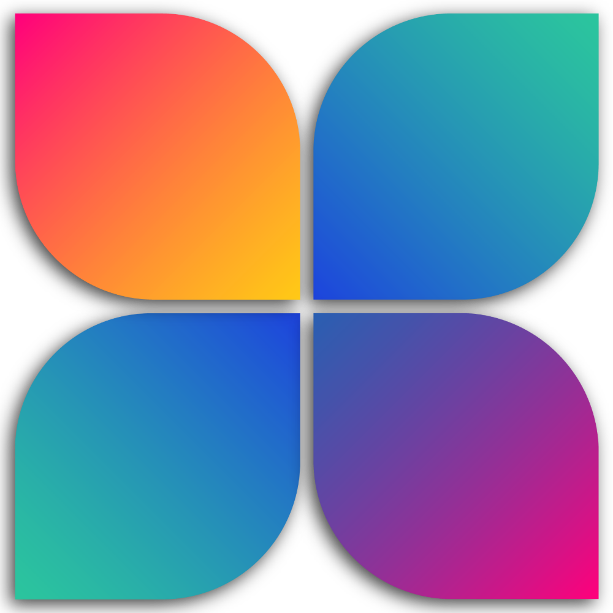

<p align="center">
  
</p>

<h1 align="center">SwiftX</h1>

<p align="center"><b>A quick-access radial ring for Windows 11.</b></p>

Summon it with a keyboard shortcut, a screen corner, or the tray icon; launch apps, files, folders
and links from it; pop groups open into an outer ring; and reach a set of built-in developer tools
(JSON/XML formatter, local secure values, Base64, certificate inspector) without leaving it.

Everything runs on your own machine. There is no account, no telemetry, and nothing is uploaded.

---

## Contents

- [Requirements](#requirements)
- [Build, test, run](#build-test-run)
- [The ring at a glance](#the-ring-at-a-glance)
- [Summoning the ring](#summoning-the-ring)
  - [Keyboard](#keyboard)
  - [Tray icon](#tray-icon)
  - [Hot corner](#hot-corner)
- [Using the ring](#using-the-ring)
- [The corner quadrant](#the-corner-quadrant)
- [Settings](#settings)
  - [Home](#home)
  - [General](#general)
  - [Apps & links](#apps--links)
  - [Tools](#tools-page)
  - [About](#about)
  - [Privacy](#privacy)
- [Built-in tools](#built-in-tools)
- [Configuration file](#configuration-file)
- [How it works](#how-it-works)
- [Tests](#tests)
- [Theme](#theme)
- [Brand and assets](#brand-and-assets)
- [Troubleshooting](#troubleshooting)
- [Roadmap](#roadmap)

---

## Requirements

- Windows 10 1809+ / Windows 11
- [.NET 10 SDK](https://dotnet.microsoft.com/download)
- x64 or ARM64

## Build, test, run

```bash
dotnet build src/SwiftX/SwiftX.csproj -p:Platform=x64
dotnet test  tests/SwiftX.Tests/SwiftX.Tests.csproj -p:Platform=x64
dotnet run   --project src/SwiftX/SwiftX.csproj -p:Platform=x64
```

Substitute `-p:Platform=ARM64` on ARM hardware. Or launch the built `SwiftX.exe` from
`bin\x64\Debug\net10.0-windows10.0.26100.0\win-x64\`.

Only one SwiftX runs at a time per data directory: a second launch notices the first and exits
rather than starting a rival tray icon and hotkey. The lock is keyed to the data directory, so a
test instance pointed at a different `SWIFTX_DATA_DIR` can run alongside your real one.

---

## The ring at a glance

The ring is a **transparent, always-on-top overlay** the size of the monitor's work area. Only the
items themselves take input; every other pixel of that window is click-through, so the ring can
cover the screen without getting in the way of it.

| Piece | What it is |
|-------|------------|
| **Hub** | The app mark at the center, floating on a soft drop shadow rather than sitting flat on the wallpaper. Not a button for launching — clicking it closes an open group, or dismisses the ring when none is open. Fixed size; no setting scales it. It turns a quarter turn as the ring is summoned, its four petals unfurling clockwise a beat apart, and unwinds the same way on dismissal. |
| **Slots** | Eight positions around the ring, 45° apart, slot 0 straight up and advancing clockwise. |
| **User slots** | The first six. Filled from your items in order; empty ones are simply not drawn. |
| **Settings** | Always slot 7. A group: hovering it pops out its **Add new** quick action; clicking it opens the Settings window. |
| **Close** | Always slot 8. Quits SwiftX. It shrinks rather than grows under the pointer, so it never reads as an invitation. |
| **Tools** | One of the six user slots by default — a single group holding every built-in tool. |
| **Flyout** | A group opens into a *concentric outer ring* around the one already on screen, up to eight children. The inner ring never moves, so you keep your bearings. |

Item kinds: **Application**, **File**, **Folder**, **Web link**, **Shortcut** (.lnk), **Group**,
and **Tool**. Icons come from the shell (matching Explorer, including .lnk overlays), from a web
link's own site icon, or from a Segoe Fluent glyph you pick.

---

## Summoning the ring

### Keyboard

`Ctrl+Shift+S` by default; press again to dismiss. Remap it in **Settings → General → Invoke** by
clicking the capture button and pressing the combination you want.

- A shortcut must include **Ctrl, Alt, or Win** — Shift alone is not enough for a system-wide key.
- Windows refuses combinations another application already owns. When that happens, the Invoke card
  says so instead of failing silently, and the old shortcut stays live until a working one is set.
- The switch beside the capture button turns the shortcut off entirely without forgetting it.

### Tray icon

- **Left-click** — summon or dismiss.
- **Right-click** — Show/Hide ring · Add item… · Settings · Quit.

"Hide ring" is a deliberate off switch: while hidden, neither the hotkey nor the hot corner brings
the ring back until you show it again.

### Hot corner

macOS-style, and on by default at the **top-left**. Push the pointer into the corner of the screen
and hold it there for a moment; the ring appears without a click.

How it behaves, and why:

| Behavior | Detail |
|----------|--------|
| **Trigger patch** | A 6-pixel square at the very corner of the display. The pointer stops dead against the screen edge when you throw it at a corner, so a few pixels is all it ever needs — anything larger starts catching deliberate travel past the corner. |
| **Dwell** | The pointer must stay in the patch for **250 ms**. A corner clipped in passing does not count. |
| **Re-arm** | Having fired, it will not fire again until the pointer leaves the patch — parking the mouse in the corner summons once, not twenty times a second. |
| **Drag guard** | While any mouse button is held, the dwell does not even start. Dragging a window into a corner still hits Windows' own snap, and a text selection that ends in a corner is not a summon. |
| **Per monitor** | The corner belongs to whichever display the pointer is on, measured against that display's full bounds rather than its work area — the corner of the *screen* is where the pointer actually stops, taskbar or not. |
| **A toggle** | Reaching the corner while the dock is already open puts it away rather than summoning a second time — the same toggle the hotkey and the tray icon already are. Parking the mouse back in the corner is a reliable way to dismiss it however it was opened. |
| **Hidden** | "Hide ring" from the tray is honored — unlike a keypress, a pointer can wander into a corner without being asked to. |
| **Detection** | The pointer is polled every 50 ms on a `WM_TIMER`, riding the same hidden message window the tray icon and hotkeys already use. No system-wide mouse hook is installed for this. |

Pick the corner and what it opens in **Settings → Home → Hot corner**: a switch, a corner
dropdown, and two choices for the shape —

- **Ring** (default) — the whole ring, drawn at the corner.
- **Quadrant** — four items only, on a quarter circle centered on the corner itself: QuickAccess,
  Notepad, Tools, and Settings by default (see [The corner quadrant](#the-corner-quadrant)).

---

## Using the ring

| Action | Result |
|--------|--------|
| **Hover** an item | Its full name pops out in a pill beside it, along the same radial the item sits on, so the label never covers the item — always in exactly one place, even for a group whose flyout is open. |
| **Hover** a group | After a short dwell it opens into the outer ring. Sweeping past on the way to a neighbour does not fire it. Its own label stays put beside the group — it never relocates to a heading above the arc, on the full ring or a quadrant alike. |
| **Click** a leaf | Launches it and dismisses the ring. Settings and Add-new are the exceptions: they open their own window and leave the ring up. |
| **Click** a group | Opens it (never toggles it shut — that would make groups flicker under a normal point-and-click). |
| **Click** the gaps | The whole disc is live: a click between two items activates whichever one the pointer is angularly nearest, exactly as clicking the item would. Nothing hovered — a gap with no item in it, or empty space past an open flyout's arc — dismisses the ring instead. |
| **Click** the hub / dead zone | Dismisses the ring, closing any open flyout along with it. |
| **Esc** | Closes an open group first, then the ring. |
| **Click anywhere else** | Dismisses. The click reaches whatever is under it — the ring is not covering the screen for input purposes. |

A group wears a short arc on its outward edge, so an item that opens a ring of its own can be told
from one that launches before you touch it.

---

## The corner quadrant

With **Quadrant** selected, the hot corner puts four items on a quarter circle whose center is the
corner of the screen itself. The pointer is already there, so every item is a short flick away.

**The geometry** adapts rather than being fixed. Two things have to hold at once — neighbouring
items must not touch, and the first and last must clear the two screen edges the corner is made of
— and both depend on the radius. So the arc starts at the ring's own radius and grows only as far
as it must, which is what keeps the layout correct at any item size and any radius you have set.
Items are then spread evenly across whatever the edge clearance leaves.

**The four items**, until you say otherwise, are:

1. **QuickAccess** — every web link and shortcut on your ring, gathered into one group, wherever
   they sit (top level or nested inside your own groups). Drops out entirely if you have none, so
   an empty group never takes a place for nothing.
2. **Notepad** — your ring's own Notepad if it has one, or the same default `SeedDefaults` plants
   on a fresh ring otherwise, so this place always opens to something.
3. **Tools**
4. **Settings**

— content first, built-ins last, the same convention the full ring reads in with Settings and
Close pinned to its own last two slots. Close is deliberately absent from the quadrant: there are
only four places, and it is dismissed the way the ring always was (Esc, a click elsewhere, or the
corner itself again). QuickAccess stays live even after you have arranged the corner by hand — a
link you add to the ring later still joins it — and so does Tools, following the Tools page's
switches the same way it does on the full ring.

**Editing the corner** happens on the Home page's canvas (see below). Until you touch it, the
corner has nothing stored and simply follows the rules above — add a link to the ring and
QuickAccess picks it up. Your first edit writes the current selection into the config, and from
then on the corner is your own arrangement; any of the four can be swapped for anything else.

Groups still work inside a quadrant: expanding one fans its children out into an outer arc, slid
back inside the quarter if it would otherwise throw half of them off the screen.

---

## Settings

Reached from the ring's Settings item, or the tray menu.

### Home

The live ring customizer — what it shows is what the ring draws, at the current size and radius.

**The canvas**

- **Click an empty slot** (or its `+`) to add an item there.
- **Click an item** to see its name and target below the size/radius cards.
- **Click a group** to reveal its children in a strip under the canvas; drag them to reorder inside
  the group.
- **Drag an item** to another slot to rearrange. A drop lands on the nearest slot, even out past
  the bubbles — the intent is the nearest place, not a pixel-perfect landing.
- **Add item… / Reset defaults** sit on the canvas itself, centered under the ring.

**Size** — Small / Medium / Large. Scales the items around the ring; the hub is unaffected.

**Radius** — 80–220 px from the hub to each item's center.

**Hot corner** — one section, two rows:

- Row 1: the switch.
- Row 2: which corner, and whether it opens the **Ring** or a **Quadrant**. Both go dead when the
  switch is off rather than disappearing and shuffling the column.

**The corner button on the canvas** appears whenever the hot corner is on, in the canvas corner
matching the one you picked. It switches the canvas between the ring and *what that corner opens* —
drawn to the same rules and at the same scale, so the two views differ in shape, not size. In that
view the corner is editable:

- **Drag** one place onto another to reorder.
- **Click the empty place** (the `+`) to add — the item belongs to the corner, not the ring.
- **Click the ×** on an item's shoulder to take it off the corner. The ring keeps it. The last item
  has no × — a corner with nothing on it would summon an empty screen.

"Reset defaults" clears your corner arrangement along with the ring, putting the corner back to
following it.

### General

| Setting | What it does |
|---------|--------------|
| **Theme** | Light, Dark, or System. Solid surfaces only. |
| **Hover style** | **Invert** (default) swaps an item's fill to the opposite theme color under the pointer, growing it slightly. **Zoom** keeps the item's resting color and just shrinks it slightly instead. Close is unaffected either way — it always goes red. |
| **Invoke** | The summon shortcut, its capture button, and an on/off switch. Reports whether Windows accepted the combination. |
| **Start with Windows** | Per-user autostart. Unpackaged builds use the `HKCU\...\Run` key (no elevation); the MSIX build uses a declared startup task, so Windows lists it in Task Manager's Startup tab and honors a user override there. |
| **Backup & restore** | Export the whole configuration to JSON, or import one back. |
| **Reset** | Restores theme, hover style, item size, radius, shortcut, hot corner, tools, and ring items to defaults. |

### Apps & links

A flat list of your ring items — show/hide each one, or delete it. Groups are listed with their
children beneath them. Built-in tools are not listed here (the Tools page owns them), and neither
are Settings and Close, which the ring always draws itself.

Its own **Add item…** button opens the same dialog as the ring's "Add to ring" quick action, but
titled "Add item" and without the Tool tile — a built-in tool already has its own home on the
Tools page, so that tile only makes sense from a ring or corner slot that can actually hold one.

### Tools page

One row per built-in tool: a switch that puts it in the ring's Tools item or takes it out, an
open button, and a drag handle. Dragging reorders the tools inside that group.

### About

The app mark, what the app is, and its version, with links to the terms and conditions (which open
in the browser) and to the Privacy page of this same window.

### Privacy

What happens to what you put into SwiftX, in plain terms: everything stays on the device, no
tracking or analytics, secure values encrypted for your account, the tools running offline, the one
thing that touches the network, and how to export or reset your data.

---

## Built-in tools

All four run entirely on this machine. Nothing you paste or open is uploaded.

By default tool windows are **reused** — opening a tool a second time brings the existing window
forward rather than stacking another one up (`ReuseToolWindows` in the config file).

### Data Formatter

Auto-detects and works with **JSON and XML**.

- Basic bar: **Format**, **Validate** (clean + pretty-print), **Copy**, **Clear**, **Save**.
- Pasting into the editor formats and detects the type immediately — not just on the debounced
  keystroke-by-keystroke detection that typing gets.
- Advanced sidebar: **Minify**, **Sort keys**, **Escape/Unescape**, **Convert to JSON/XML**, and
  indent width.
- XML parsing is hardened against the usual entity-expansion and external-entity traps.

### Secure values

A local key/secret store. Values are masked in the list, copy to the clipboard on demand, and are
protected with Windows' own per-user encryption (DPAPI) — readable only while signed in to that
account on that device.

### Base64

Encode and decode text, with a URL-safe alphabet option, and encode a file's bytes directly.

### Certificate

Inspects `.cer` / `.crt` / `.der` / `.pem`, PKCS#7 bundles, password-protected PKCS#12/PFX, and Java
KeyStore (`.jks`) files, showing full field detail for every certificate in the file.

---

## Configuration file

Stored at `%AppData%\SwiftX\ring.json`. Set `SWIFTX_DATA_DIR` to put it (and the icon cache)
somewhere else — useful for a portable install or for running a test instance beside your real one,
since the single-instance lock is keyed to the data directory too.

Writes are atomic (written to a temporary file, then moved into place), and a config that fails to
parse falls back to defaults rather than taking the app down with it.

### Top-level keys

| Key | Type | Default | Meaning |
|-----|------|---------|---------|
| `Rings` | array | one profile | Ring profiles. Only the first is used today; it holds your items. |
| `LaunchAtStartup` | bool | `false` | Mirrors the "Start with Windows" switch. |
| `Theme` | `Light`/`Dark`/`System` | `Dark` | Window and ring theme. |
| `HoverStyle` | `Invert`/`Zoom` | `Invert` | How a ring item reacts to the pointer — swap to the opposite color, or keep color and shrink slightly. |
| `Hotkey` | string | `"Ctrl+Shift+S"` | Summon shortcut, in readable form so a hand-edited file stays legible. |
| `HotkeyEnabled` | bool | `true` | Whether the shortcut is registered at all. |
| `HotCornerEnabled` | bool | `true` | Whether a screen corner summons the ring. |
| `HotCorner` | `TopLeft`/`TopRight`/`BottomLeft`/`BottomRight` | `TopLeft` | Which corner. |
| `HotCornerLayout` | `Ring`/`Quadrant` | `Ring` | Whether that corner opens the whole ring or the quarter circle. |
| `HotCornerRing` | array | empty | Your corner arrangement. Empty means "follow the ring" — see below. |
| `ItemSize` | `Small`/`Medium`/`Large` | `Medium` | How large ring items are drawn. |
| `RingRadius` | number or null | `null` (100) | Distance from hub to item centers, 80–220. |
| `ShowDataTool` | bool | `true` | Data Formatter in the ring's Tools item. |
| `ShowSecureValuesTool` | bool | `true` | Secure values in the Tools item. |
| `ShowBase64Tool` | bool | `true` | Base64 in the Tools item. |
| `ShowCertificateTool` | bool | `true` | Certificate in the Tools item. |
| `ReuseToolWindows` | bool | `true` | Reopening a tool reuses its window. No UI switch; config only. |
| `Seeded` | bool | — | Set once, after the first run has planted the default items. |

### Ring items

Each entry in `Rings[0].Items` (and in a group's `Children`, and in `HotCornerRing`):

| Field | Meaning |
|-------|---------|
| `Id` | Stable identity. `HotCornerRing` entries are matched back to ring items by this. |
| `Kind` | `Application`, `File`, `Folder`, `WebLink`, `Shortcut`, `Group`, or `Tool`. |
| `DisplayName` | The label in the hover pill. |
| `Target` | Path, URL, or tool name (`Data`, `SecureValues`, `Base64`, `Certificate`). Groups may carry a marker target — the Tools group uses `swiftx:toolsgroup`. |
| `Arguments` | Command-line arguments, for the kinds that launch something. |
| `CustomIconPath` | An icon file to use instead of the resolved one. |
| `CustomGlyph` | A Segoe Fluent codepoint (or short text such as `B64`) to draw instead of an icon. |
| `Hidden` | Kept in the config but not drawn. The Tools page's switches work by setting this. |
| `Children` | A group's items. |

Settings, Close and Add-new are **never** stored — the ring synthesizes them at render time, which
is why they cannot be reordered, hidden, or deleted, and why they never appear in Apps & links. A
config written by an older build that did store them is repaired on load.

### How `HotCornerRing` resolves

Empty means the corner follows the ring: the four places are QuickAccess (every web link and
shortcut on the ring, gathered into one group), Notepad (the ring's own, or a default stand-in),
Tools, and Settings, recomputed every time. Once you arrange the corner by hand the list is
written out, and each entry is mapped back to the live thing it names before it is drawn —
Settings to the synthesized entry, `swiftx:toolsgroup` to the Tools item on the ring (so the Tools
page's switches still govern its children), `swiftx:quickaccess` to a freshly gathered QuickAccess
group (so it too keeps up with new links and shortcuts after being locked into an arrangement),
everything else to the ring item with the same `Id`. An entry naming something that has since left
the ring — including a QuickAccess with nothing left to gather, or a Notepad the ring never really
had — keeps working from its own stored copy, which is what lets the corner hold an item the ring
itself does not.

### Migrations run at startup

1. Stored Settings/Close entries from older builds are stripped.
2. Ring items pointing at the retired `Json` / `Xml` tool targets are rewritten to `Data`, and the
   duplicates that creates are collapsed.
3. **Tools are gathered into one group.** The group is found by its marker target first and by name
   second (which adopts the "Dev tools" group earlier builds seeded), tools from the top level and
   from other groups are moved in, duplicate kinds are dropped, and any built-in tool the ring had
   no item for is added. A group created by this step takes the ring slot of the first tool it
   absorbed. A ring with no tools *and* no group is left alone — deleting them should not undo
   itself on the next launch.
4. Every tool item's `Hidden` flag is re-pointed at the Tools page's switches.

The config is re-saved only when one of these actually changed something.

---

## How it works

```
src/SwiftX/
  App.xaml.cs              Startup, single-instance lock, unhandled-exception guard
  RingManager.cs           Owns config, tray, hotkey, hot corner, windows, activation
  RingWindow.xaml(.cs)     The ring itself: layout, animation, hover, flyout, input
  SettingsWindow.xaml(.cs) Settings shell and every page in it
  AddItemWindow.xaml(.cs)  "Add to ring" / "Add item", including drag-and-drop from Explorer

  Models/
    AppConfig.cs           Persisted settings
    RingItem.cs            One ring entry
    RingProfile.cs         One ring's items
    RingMetrics.cs         All ring geometry, as one set of derived numbers
    SystemRingItems.cs     Settings / Close / Add-new, synthesized not stored
    ToolCatalog.cs         The built-in tools, and the Tools-group migration
    HotCorner.cs           Corner enum, layout enum, and the trigger-patch test
    QuadrantLayout.cs      The quarter circle: radius, angles, corner mapping, item pick
    HotCornerItems.cs      What the corner shows: default pick vs stored arrangement
    HotkeyGesture.cs       Parse/format a system-wide shortcut

  Services/
    MessageWindow.cs       One hidden HWND: tray callbacks, WM_HOTKEY, WM_TIMER
    HotkeyService.cs       RegisterHotKey, keyed by id
    HotCornerWatcher.cs    Pointer polling, dwell, re-arm, drag guard
    TrayIconService.cs     Notification-area icon and its native menu
    WindowChrome.cs        Borderless/transparent/hit-region window plumbing
    IconService.cs         Shell icons (jumbo), favicons, disk cache
    RingStore.cs           Load/save/import/export
    Launcher.cs            Starting whatever an item points at
    SecureValueStore.cs    DPAPI-protected key/secret storage
    AppLogo.cs             The SwiftX mark, as vector geometry (see Brand and assets)
    Formats/, Syntax/      JSON/XML parsing, validation, tokenizing
  ToolPages/               The four tool UIs
  Controls/AppTitleBar.cs  Title bar for the app's own and the tool windows
  Interop/NativeMethods.cs The Win32 surface, grouped by what needs it

  Assets/SwiftX.ico        Executable icon; also the shell and tray icon
  Images/                  MSIX tile set

docs/SwiftX.png            Master art every raster asset is generated from
docs/TERMS.md              Terms and conditions, linked from Settings > About
tools/                     One-off maintenance scripts (brand asset generation)
```

Two design notes worth knowing before changing things:

- **Geometry lives in `RingMetrics`.** Bands are derived from one radius through
  `FlyoutRadiusFor`, `FlyoutBandStartFor`, `ContentRadiusFor` and friends, which is what lets the
  same drawing code serve both the full ring and the quarter circle — the quadrant just feeds in a
  different radius.
- **The overlay's hit region is real clipping.** `WindowChrome.SetEllipticHitRegions` clips DWM's
  composited pixels, not just input, so the region must bound everything painted — hover growth and
  an open flyout included, plus a second circle around the hover pill while one is showing.

---

## Tests

```bash
dotnet test tests/SwiftX.Tests/SwiftX.Tests.csproj -p:Platform=x64
```

The suite covers the parts that can be reasoned about without a window on screen:

- `Models/HotCornerZoneTests` — the trigger patch: the corner pixel of each corner, only ever one
  corner matching, mid-edge and off-display rejection, displays at a negative origin, and the clamp
  that stops an oversized patch swallowing half the screen.
- `Models/QuadrantLayoutTests` — every item wholly on screen from all four corners, no two touching,
  the round trip between corner-local and canvas angles, a radius left alone when it already fits,
  and which items the corner picks by default: QuickAccess gathering links and shortcuts from
  anywhere on the ring (skipping hidden ones, dropping out when there's nothing to gather), and
  Notepad preferring the ring's own over the synthesized fallback.
- `Models/HotCornerItemsTests` — following the ring until edited, seeding on first edit, an
  arrangement surviving ring changes, QuickAccess and Tools staying live once locked into an
  arrangement, the fallback copy for an item that left the ring, reset, and the four-place cap.
- `Models/ToolsGroupTests` — the Tools-group migration: adoption by name, consolidation, adding a
  missing tool, slot placement, and leaving an intentionally tool-free ring alone.
- `Models/HotkeyGestureTests`, `Models/SystemRingItemsTests`.
- `Formats/…` — JSON/XML formatting, validation, sanitizing, and XML security.
- `Services/…` — the round trip through `RingStore`, item construction, icon identity, Base64,
  the certificate and JKS readers, value masking, the display-bounds cache, and code folding.
- `Security/…` — general hardening, bounds on every input whose length a remote party or an
  opened file gets to choose, and the lifetime of a secret in memory and on the clipboard.
- `Performance/PerformanceBudgetTests` — the tool pipelines staying interactive on heavy payloads,
  and growing with the size of their input rather than its square.
- `Resilience/CrashAndHangRegressionTests`, `Load/ConcurrencyAndEnduranceTests` — malformed and
  hostile input, and sustained concurrent use.

The suite runs against a throwaway data directory, not your real one. `TestEnvironment` points
`SWIFTX_DATA_DIR` at a unique temp path from a `[ModuleInitializer]`, which has to happen before
anything reads `RingStore.DataDirectory` — it is a `static readonly` resolved once per process, so
a fixture or per-test setup would already be too late. This is data-loss prevention rather than
hygiene: `SecureValueStore` and `RingStore` both save whole-file, so a test writing through them
without the redirect would replace the running user's real store outright, with no backup.

---

## Theme

Solid **black** (Dark) or solid **white** (Light) surfaces only — no acrylic, Mica, or glass.
System follows Windows and re-themes open windows as it changes. In Settings, the sidebar sits a
shade lighter/greyer than the content area beside it (Dark: `#141414` pane against `#000000`
content) so the two read as distinct panels rather than one seamless field.

---

## Brand and assets

The SwiftX mark is four gradient petals pinwheeled around a cross-shaped gap. Each petal is a
square with two opposite corners left sharp and the other two rounded off hard; the sharp pair
always straddles the middle, so one corner points into the centre and its opposite forms an outer
corner of the mark.

`docs/SwiftX.png` (1000x1000 RGBA) is the master. Every raster asset is derived from it:

| Asset | Where it shows up |
|-------|-------------------|
| `src/SwiftX/Assets/SwiftX.ico` | The executable's icon, and so also Explorer, Alt-Tab, and the notification-area icon. Nine frames, 16px through 256px. |
| `src/SwiftX/Images/Square*.png`, `Wide310x150Logo.png`, `StoreLogo.png`, `SplashScreen.png` | The MSIX tile set. SwiftX ships unpackaged (`WindowsPackageType=None`), so these are staged for packaging rather than read at runtime. |

Regenerate all of them after changing the master:

```bash
python tools/generate-brand-assets.py     # needs Pillow
```

Unplated icons (the `targetsize-*` set, `StoreLogo`) fill their frame the way shell icons do; the
plated tiles inset the mark inside a transparent margin, per Microsoft's tile guidance, so it reads
at a consistent weight across the set.

### The in-app mark

The logo drawn *inside* the app is not a bitmap. `Services/AppLogo.cs` composes it as live vector
geometry over a 48x48 design box, wrapped in a `Viewbox`, so it stays crisp at any hub size and any
display scale with nothing to resample. It appears in four places: the ring's hub, the ring preview
on the Settings home page, the Settings About card, and the title bar of SwiftX's own windows
(Settings, and Add to ring) — those extend content into the caption, so Windows never draws a
window icon for them and without this they would carry no mark at all.

It comes in two forms. `AppLogo.Create` is the flat mark, for the About card and the title bars,
where it sits on a solid surface. `AppLogo.CreateFloating` adds a composition drop shadow — one per
petal, masked by what the petal actually paints, so the shadow is the mark's own pinwheel outline
rather than a box behind it — and that is what the ring's hub and its preview use, because there the
mark is painted straight onto the desktop with nothing under it to give it any depth of its own.

Either form can play itself in and out (`AppLogo.Mark.PlayEntrance` / `PlayExit`), which is what the
hub does on a summon and a dismissal: the whole mark swings a quarter turn while each petal, going
round clockwise from the top-left a beat apart, untwists and grows into its quadrant; the dismissal
is that rewound, last petal in first out. Only the petal layer turns — the shadow stays put, the way
one does when the thing above it spins rather than the light moving.

Its geometry and palette were measured off the master, and the two are kept in step by hand — a
brand change means re-exporting `docs/SwiftX.png`, re-running the script above, and updating the
constants in `AppLogo.cs`. The gradients run from each petal's outer corner to the corner facing
the centre:

| Petal | Outer | Centre |
|-------|-------|--------|
| Top-left | `#FF0A76` | `#FFD510` |
| Top-right | `#2CD098` | `#1D4ADB` |
| Bottom-left | `#2CD098` | `#1D4ADB` |
| Bottom-right | `#F1067E` | `#1A65B5` |

These are hard-coded rather than theme resources on purpose. SwiftX themes are hard black and hard
white, and the mark has to read as *coloured* against both rather than inverting with the theme.


## Troubleshooting

**The shortcut does nothing.** Another application owns that combination; Windows will not share
it. The Invoke card says so — pick a different one.

**The hot corner does nothing.**
- Check it is on, and which corner is selected, in Settings → Home.
- Hold the pointer *in* the corner for a moment — a pass-through does not count.
- Let go of the mouse button: a held button suppresses it on purpose.
- It is the corner of the display the pointer is on, not of the desktop as a whole.
- "Hide ring" from the tray suppresses it until you show the ring again.

**A tool is missing from the ring.** Tools live inside the Tools item. If that item was deleted,
re-add a group named `Tools` (or restore defaults) and the next launch will fill it.

**Something looks wrong on screen.** SwiftX writes a diagnostic log to `%TEMP%\swiftx.log`,
recreated on each launch. Window, hotkey, and hot-corner failures are recorded there.

**Start fresh.** Quit SwiftX and delete `%AppData%\SwiftX` (or whatever `SWIFTX_DATA_DIR` points
at). The next launch reseeds the defaults.

---

## Roadmap

Not started; noted here as candidates.

**Ring**

- A second ring when items outgrow the first
- Rotating the ring
- Alternative layouts: pyramid, timer scroll
- Configurable hot-corner dwell, and more than four places in a quadrant

**Data Formatter** — commonly offered elsewhere, roughly in order of how well each fits the current
sidebar-button architecture:

- **YAML conversion** — fits the existing "Convert to JSON/XML" pattern directly (add a YAML
  `IDataFormat` to `FormatRegistry`).
- **JSONPath query** — a query box that filters/highlights matches; a new interaction, not just a
  button.
- **Tree view** — a collapsible node view of the parsed document, alongside or instead of the text
  editor; a bigger UI addition.
- **Diff/compare** — a two-document comparison; likely its own tool page rather than a Data
  Formatter sidebar addition, given the two-pane layout it needs.
